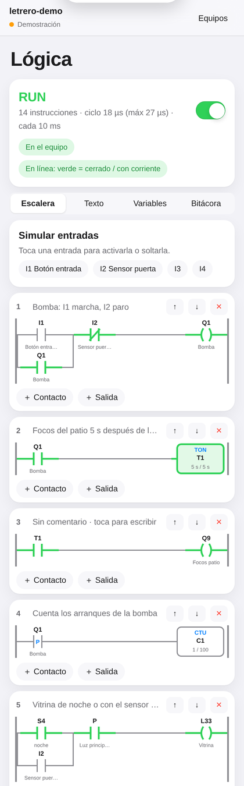

# AP LÓGICA: programar un equipo AP ELECTRIC como un PLC

Desde la versión **2.3** del programa, cada AP UNO, AP CORE, AP NODE o AP GATE tiene un **PLC dentro**. El programa del usuario se escribe en **escalera (Ladder)** o en **lista de instrucciones (IL)**, al estilo de la norma IEC 61131-3, desde la pestaña **Lógica** de AP Studio. El equipo lo ejecuta solo, aunque no haya internet ni app abierta.

> **Estado:** el motor está probado en la PC (pruebas en C++ y en JS con los mismos casos) y el programa compila para el ESP32-C3. Todavía no se ha probado en un equipo fabricado.



## Cómo trabaja

1. Cada **10 ms** el equipo lee la imagen de entradas (I, A, R, S).
2. Recorre el programa **de arriba abajo**, renglón por renglón.
3. Escribe las salidas que cambiaron (Q, L, P).

- **RUN / STOP:** el interruptor de la pestaña Lógica o la orden `PLC RUN` / `PLC STOP`. El equipo recuerda el modo al reiniciar.
- **Al pasar a STOP**, las salidas que el programa usa (OUT y SET de Q y L) se **apagan**.
- **Las salidas que usa el programa le pertenecen:** si un renglón dice `OUT Q1`, esa salida la manda el programa en cada ciclo. Las reglas y los botones de la app pueden manejar las salidas que el programa no toca.
- **Vigilante (watchdog) de 15 s:** si el programa principal se traba, el equipo se reinicia. La bitácora registra que el arranque fue por el vigilante.

## Áreas de memoria

| Área | Qué es | Rango |
|---|---|---|
| **I** | Entradas (AP UNO E1-E4, AP INPUT, nodos) | I1-I128 |
| **Q** | Salidas (AP UNO S1-S4, DO8, AP RED 4 = Q9-Q12…) | Q1-Q128 |
| **M** | Marcas internas. **M65-M128 se recuerdan** al apagar | M1-M128 |
| **T** | Temporizadores | T1-T16 |
| **C** | Contadores. **Se recuerdan** al apagar | C1-C16 |
| **L** | Luminarias (PWM4, AO4, AP FOCO = L33-L36) | L1-L36 |
| **P** | Luz principal (encendido general) | P |
| **A** | Entradas analógicas AI4, en V o mA (solo para comparar) | A1-A8 |
| **R** | Puntos Modbus RTU (solo para comparar) | R1-R8 |
| **S** | Sistema: **S1** primer ciclo, **S2** pulso de 1 s, **S3** siempre 1, **S4** es de noche (horario solar o sensor de luz), **S5** hay falla | S1-S5 |

## Instrucciones

| Escalera | Lista de instrucciones | Qué hace |
|---|---|---|
| ─\| \|─ contacto abierto | `LD x` · `AND x` · `OR x` | Conduce si x = 1 |
| ─\|/\|─ contacto cerrado | `LDN x` · `ANDN x` · `ORN x` | Conduce si x = 0 |
| ─\|P\|─ flanco de subida | `LDP x` · `ANDP x` · `ORP x` | Conduce un solo ciclo cuando x pasa a 1 |
| ─\|N\|─ flanco de bajada | `LDF x` · `ANDF x` · `ORF x` | Conduce un solo ciclo cuando x pasa a 0 |
| [A1 > 3.5] comparación | `LD A1 > 3.5` (`>`, `<`, `>=`, `<=`, `=`, `<>`) | Para A, R, C (cuenta) y T (ms) |
| ramas en paralelo | `LD … ORB` · `LD … ANB` | Une bloques (como los paréntesis) |
| | `NOT` | Invierte el resultado (solo en Texto) |
| ─( )─ bobina | `OUT x` | x = resultado del renglón |
| ─(S)─ enclavar | `SET x` | Pone x en 1 y lo deja así |
| ─(R)─ soltar | `RST x` | Pone x en 0; con T o C los pone a cero |
| TON | `TON Tn ms` | Retardo al conectar: Tn = 1 cuando la entrada lleva ms encendida |
| TOF | `TOF Tn ms` | Retardo al desconectar: Tn sigue en 1 ms después de apagarse la entrada |
| TP | `TP Tn ms` | Pulso de ms al subir la entrada, aunque siga encendida |
| CTU | `CTU Cn preset` | Cuenta cada subida; Cn = 1 al llegar al preset |
| CTD | `CTD Cn preset` | Empieza en el preset y baja; Cn = 1 al llegar a 0 |

Notas:

- **Comentarios:** `//` o `;`.
- **Mayúsculas y minúsculas:** da igual.
- **Bobinas:** varias seguidas comparten el mismo resultado.
- **Tamaño:** hasta **256 instrucciones** por programa.

## Ejemplo: arranque y paro de una bomba con retardo y contador

```
// Bomba: I1 marcha, I2 paro (autorretención)
LD I1
OR Q1
ANDN I2
OUT Q1
// Focos del patio 5 s después de arrancar
LD Q1
TON T1 5000
LD T1
OUT Q9
// Cuenta los arranques (se recuerda al apagar)
LDP Q1
CTU C1 100
```

En la escalera de AP Studio este programa se ve como tres renglones. Con el equipo en RUN, la vista **en línea** marca en **verde** cada contacto que conduce y cada bobina con corriente, y los temporizadores muestran su tiempo («2.3 s / 5 s»).

## Plantillas incluidas

Arranque y paro con autorretención · retardo a la conexión · minutero de escalera · contador de piezas · bomba por nivel 4-20 mA · alternancia de dos bombas · destello de alarma · fachada solo de noche.

## Por la red (para integradores)

| Ruta | Qué hace |
|---|---|
| `GET /plc` | El programa (texto) |
| `POST /plc` (cuerpo: texto) | Lo compila, lo guarda y responde `{"ok":1,"n":14}` o `{"ok":0,"err":"renglon 3: ..."}` |
| `/api?c=PLC RUN` · `PLC STOP` · `PLC BORRAR` · `PLC MAX` | Modo, borrar el programa, reiniciar el tiempo máximo de ciclo |
| `/api` → `"plc"` | `run`, `n`, `err`, `us` / `usm` (tiempo de ciclo y máximo, µs), `m` (M1-M128 en hexadecimal), `fl` (estado de cada instrucción, para el monitoreo), `t` / `tq`, `c` / `cq` |
| `GET /log` | Bitácora: los últimos 32 eventos (arranques, fallas, RUN/STOP, programas nuevos), con hora |

Las marcas M65-M128 y los contadores se guardan en la memoria como máximo **una vez por minuto** (cuida la flash) y al pasar a STOP.

## Archivos

- `ap1-prog/firmware/LetreroLabAP1/logica.h`: el motor (sin dependencias del hardware).
- `ap1-prog/firmware/pruebas/prueba_logica.cpp` y `ap-studio/pruebas/prueba_logica.cjs`: pruebas. `bash tools/probar_apbus.sh` corre las dos.
- `ap-studio/index.html`: el editor (pestaña Lógica), con el mismo motor en JS para verificar y para el modo demostración.
