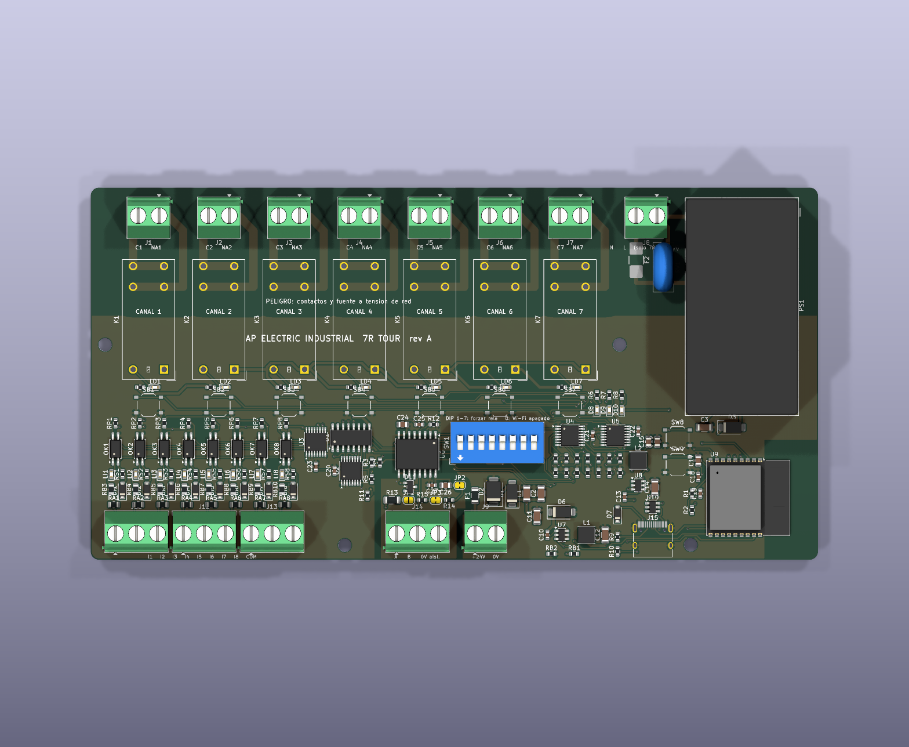

# AP Electric Industrial · 7R Tour: placa rev A (CONCEPTO)



Una placa sirve para dos SKU. Cambia lo que se monta, no el diseño.

| SKU | Alimentación | Se monta | BOM / CPL para JLCPCB |
|---|---|---|---|
| **7R Tour 24DC** | 24 V CC de una fuente certificada externa (J9) | Todo menos J8, F2, RV1, PS1, D3, C3 | `fabricacion/jlcpcb/AP_7R_TOUR_24DC_*.csv` |
| **7R Tour CA** | Red de 127/220 VCA a J8; fuente encapsulada Mean Well IRM-20-24 en la placa | Todo | `fabricacion/jlcpcb/AP_7R_TOUR_CA_*.csv` |

Los Gerbers y taladros son los mismos para los dos: `fabricacion/jlcpcb/AP_7R_TOUR_gerber_JLCPCB.zip`.

Los archivos `AP_7R_TOUR_BOM_JLCPCB_solo_SMD.csv` y `AP_7R_TOUR_CPL_JLCPCB_solo_SMD.csv` corresponden a la placa CA con las piezas de patas soldadas a mano. Ver `RESUMEN_JLCPCB.txt`.

## Estado de cierre (comprobado por software)

| Revisión | Resultado |
|---|---|
| ERC del esquema (KiCad 9) | 0 errores |
| DRC con las reglas propias (`kicad/AP_7R_TOUR.kicad_dru`) | 0 violaciones, 0 sin conectar, paridad esquema-placa 0 |
| Reglas de fabricación de JLCPCB (DFM) | 0 problemas |
| Códigos LCSC | 55 tipos y 178 piezas por placa, todos con código; relés, fuentes, aislador y bornes verificados en lcsc.com / jlcpcb.com |

Que el DRC pase **no** significa que el producto esté listo para vender. Faltan fabricar, medir, ensayar y certificar (ver `../PLAN_VERIFICACION.md`).

## Reglas de aislamiento del DRC

Son requisitos de diseño propuestos, sin ensayo todavía.

| Entre | En el aire | Por la superficie | Notas |
|---|---|---|---|
| Red (contactos, L, N, LF) y todo lo demás | 6.4 mm | 6.4 mm | Meta de aislamiento reforzado para 250 V, grado de contaminación 2 (IEC 60664-1); a confirmar con la norma de producto |
| Redes de red distintas (canal con canal, contacto abierto) | 2.0 mm | 2.4 mm | Entre las patas de una bornera de 5.08 mm hay 2.48 mm |
| Bus RS-485 aislado (RSA, RSB, GNDB, VISO, TERM, PA, PB) y la lógica | 1.5 mm | — | Aislamiento **funcional**: protege contra lazos de tierra y sobretensiones del cable. **No** es de seguridad |

Toda la red está arriba de y = 32 mm y sin relleno de cobre.

El lado del bus está trazado a mano en `gen/make.py` (`PRE`, `PREVIAS`), dentro de la zona GNDB. Al rutear, una zona prohibida 1.6 mm más grande impide que el ruteador acerque la lógica; se quita antes del relleno final.

## Rehacer

```
cd hardware
bash tools/rutear.sh ap-electric/7r-tour AP_7R_TOUR     # placa y ruteo con Freerouting
python3 ap-electric/7r-tour/gen/variantes.py ap-electric/7r-tour/fabricacion/jlcpcb   # BOM/CPL por SKU
```

## Pendientes concretos de esta placa

1. Medir la irrupción de lámparas LED reales y fijar el límite por canal. Hoy es **PD**; la meta es 10 A resistivos.
2. Confirmar que el relé G2RL-1A-E aguanta la irrupción medida. Si no alcanza, cambiar a una versión para cargas capacitivas o a un contactor externo.
3. Comprobar en la pieza real la distancia de aislamiento de los bornes KF128 y del relé, porque el DRC solo ve el cobre.
4. Comprobar el fusible de red del SKU CA (F2, T2A 250 VCA, 2410) contra la irrupción medida de la IRM-20-24 y su coordinación con el interruptor del tablero.
5. Revisar la serigrafía «PELIGRO» que cruza el contorno de K3. Es estético y pasa el DFM.
6. Fabricar 3 prototipos y seguir el banco de `../PLAN_VERIFICACION.md`.
