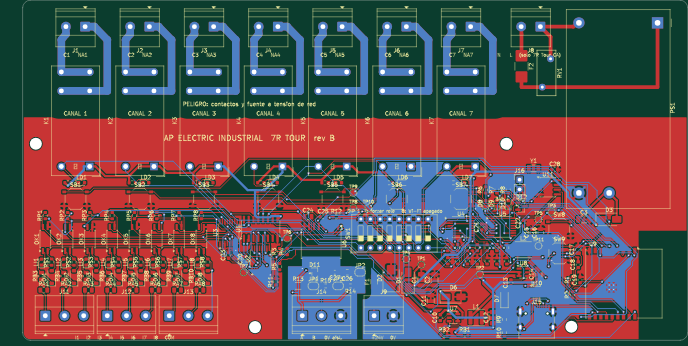
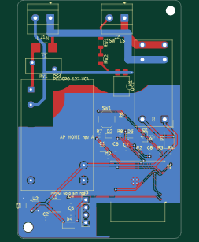
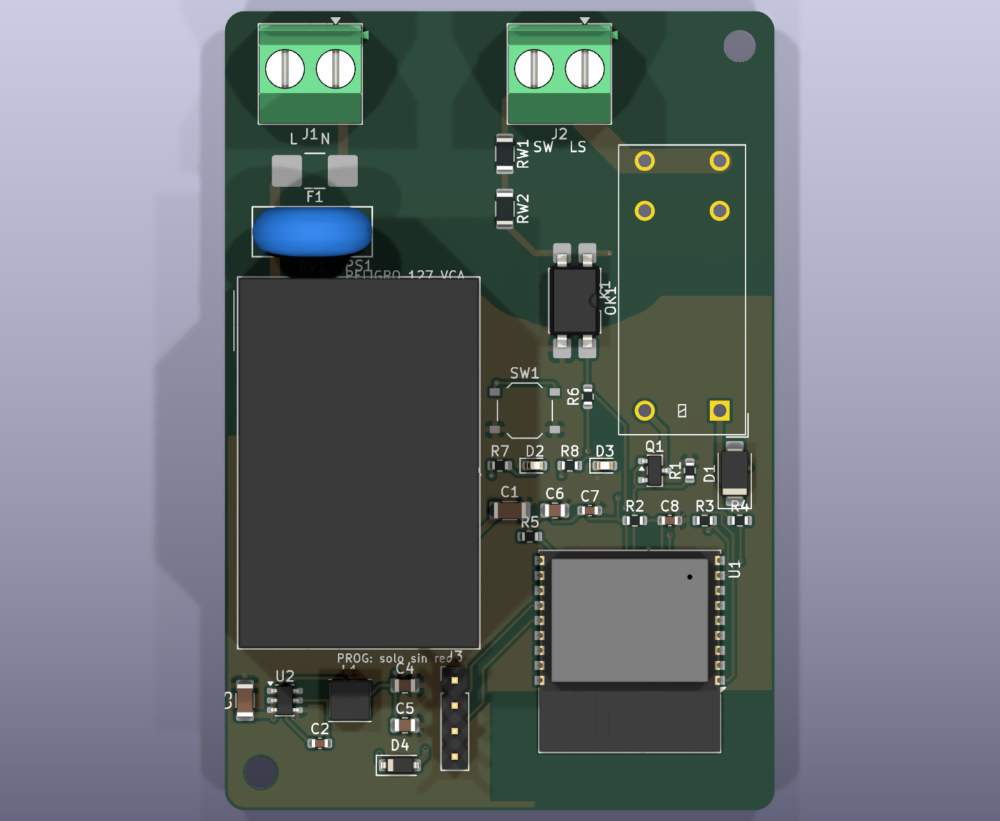

# Diseño final de las placas (rev B): vista, entradas, salidas, voltajes y segmento

> **Estado: diseño cerrado por software; nada fabricado ni medido.** Las vistas son exportaciones del diseño real (`kicad/*.kicad_pcb`), no fotos. Las cifras de capacidad marcadas **PD** están por determinar por ensayo. No hay certificación y ninguna placa es una función de seguridad.
> Marcas: **[E]** hoja del componente · **[R]** requisito de diseño · **[C]** cálculo · **PD** por determinar.

## Resumen: dos placas, cuatro SKU, tres segmentos

| Placa | SKU | Voltaje de trabajo | Segmento | Decisión actual |
|---|---|---|---|---|
| **7R Tour rev B** (176 × 90 mm) | **7R Tour 24DC** = **AP Monitor 24** | **24 V CC** de una fuente certificada externa (diseño 19.2-30 V [R]) | **Industrial**: máquinas, andon, OEE, tableros | **Piloto / primera tanda de 5 placas** |
| | 7R Tour CA | 85-264 V CA a la fuente integrada (Mean Well IRM-20-24 [E]) | Industrial y alumbrado en tablero | En pausa hasta pruebas de seguridad eléctrica |
| **AP Home rev A** (55 × 80 mm) | Home Plug | 127 V CA, 60 Hz [R] | **Hogar**: una lámpara enchufable | Congelado (consumo y certificación) |
| | Home Switch | 127 V CA, con fase y neutro [R] | **Hogar**: un circuito de alumbrado con apagador | Congelado |

Segmentos fuera de estas placas: **Luz/LED** (letreros, AP FOCO, PWM4) se mantiene como línea aparte y no usa estas placas.

---

## 1. 7R Tour rev B (industrial)

### Vistas

| Pistas de las dos caras (rojo = arriba, azul = abajo) | 3D superior |
|---|---|
|  |  |

- Cara superior sola: [AP_7R_TOUR_cara_superior.png](diseno_final/AP_7R_TOUR_cara_superior.png) · cara inferior (espejada): [AP_7R_TOUR_cara_inferior.png](diseno_final/AP_7R_TOUR_cara_inferior.png) · 3D perspectiva e inferior en `7r-tour/fabricacion/3d/`.
- **Arriba de la placa** (franja de y < 31 mm): los siete relés y sus pistas anchas de **2 mm en las dos caras, cobre de 2 oz**. Es la zona de contactos, separada de la lógica por **ranuras y ≥ 6.4 mm** de aislamiento.
- **Parte baja**: lógica de 24 V, ESP32-C3, expansores, entradas aisladas, RS-485 aislado y bornes.
- Las 3 redes largas (INT, RS_DE, RS_RX) las trazó una herramienta propia (`tools/ruta_auto.py`); conviene revisarlas en KiCad antes de pedir.

### Voltajes
| Punto | Valor |
|---|---|
| Entrada de alimentación (24DC) | 24 V CC; fusible rápido de 3 A, diodo contra polaridad invertida y supresor SMBJ33A [E] |
| Interno | 5 V (regulador) y 3.3 V (lógica y ESP32); consumo ≈ 3.6 W con 7 relés [C] |
| Bobinas de relé | 24 V CC |
| Contactos de salida | Meta **250 V CA** monofásico [R]; capacidad del relé 16 A 250 V CA resistivo [E]; **límite del producto: PD** (meta 10 A por canal) |
| Bus RS-485 | Aislado 5 kVrms con su propia fuente [E] |

### Salidas (7)
| Canal | Tipo | Bornera | Notas |
|---|---|---|---|
| 1 a 7 | Contacto seco normalmente abierto, **común independiente por canal** | 7 × KF128 de 2 polos (J1-J7) | Relé Omron G2RL-1A-E DC24; LED de bobina por canal; sin bobina el contacto abre |

Capacidad, irrupción de LED y corriente total simultánea: **PD**. Motores y bombas solo con contactor externo.

### Entradas (8) y comunicación
| Función | Detalle | Borneras |
|---|---|---|
| **Entradas 1-8** | **24 V CC tipo PNP** (el sensor da +24 V; el 0 V del sensor va a COM). Optoaisladas LTV-217. Encendida > ≈ 11 V, apagada < ≈ 5 V, ≈ 4.8 mA, máx. 30 V. LED por entrada | 3 bloques KF128 de 3 polos: I1-I8 + COM |
| **No sirven** | Sensores **NPN** directos (primera mejora de la rev C) | |
| **Conteo rápido** | Entradas 1 y 2 también van a IO0 e IO20: conteo por interrupción (~500 pulsos/s como máximo) | |
| **RS-485 aislado** | Modbus RTU esclavo: A, B y 0 V aislado; terminación de 120 Ω por puente | 1 bloque de 3 polos |
| **Wi-Fi** | ESP32-C3-WROOM-02; apagado de fábrica; radio **sin homologar** | |
| **USB-C** | Programación y consola | |
| **Reloj** | PCF8563 con batería externa (conector de 2 polos); conserva la hora sin red | |
| **Mando manual** | 7 botones de canal (por programa) y DIP 1-7 que fuerzan cada relé **por hardware**; DIP 8 apaga el Wi-Fi | |
| **Puntos de prueba** | 24 V, 5 V, 3.3 V, 2 × 0 V, SDA, SCL, TX, RX, DE, EN | |

### Programa incluido (AP Control)
Estados de máquina PackML, conteo de piezas, causas de paro, microparos, andon, OEE, bitácora con hora, lógica tipo PLC en escalera, autoprueba (`TEST`) y tablero en AP Studio.

### Cierre por software (rev B)
ERC 0 · DRC 0 (0 sin conectar, paridad esquema-placa 0) · reglas de JLCPCB 0 · pedido revisado sin errores: **24DC 56 filas / 177 piezas; CA 59 filas / 183 piezas** (con avisos conocidos de códigos compartidos).

---

## 2. AP Home rev A (hogar)

| Pistas de las dos caras | 3D superior |
|---|---|
|  |  |

| | Home Plug | Home Switch |
|---|---|---|
| Voltaje | 127 V CA 60 Hz [R]; fuente Mean Well IRM-03-5 [E] | Igual |
| Salida | 1 relé (Omron G2RL-1A-E-HA [E]); carga máxima **PD** (meta 6 A de alumbrado [R]) | Igual: borne **LS** (fase a la lámpara) |
| Entrada | Ninguna (clavija y receptáculo encerrados) | **SW**: fase que regresa del apagador, **entrada de red** (≈ 0.64 mA a 127 V [C], optoacoplador 5 kVrms [E]); apagador sencillo, de timbre o de escalera |
| Bornes | Los de la caja del producto | **L** fase · **N** neutro · **LS** · **SW** |
| Control | Wi-Fi local, horarios, vínculos; sin nube | Igual, conservando el apagador |
| Instalación | Se enchufa | Fija, por persona competente, con el circuito desenergizado; **no cabe en la chalupa** (55 × 80 mm) |
| Segmento | **Hogar** | **Hogar** |

Estado: congelado; requiere certificación de seguridad de red antes de cualquier venta.

---

## 3. Qué placa para qué cliente

| Necesidad | Placa y SKU |
|---|---|
| Máquina sin datos: contar piezas, andon, OEE, microparos | **7R Tour 24DC (AP Monitor 24)** |
| Tablero con 7 salidas de mando, 8 entradas y Modbus | **7R Tour 24DC** (el CA cuando haya certificación) |
| Una lámpara de 127 V con Wi-Fi | AP Home (congelado) |
| Letreros y tiras LED | Línea AP LED aparte |
| Protección de personas, paro de emergencia | **Ninguna de estas placas**: usar equipo de seguridad certificado |

## 4. Cómo pedir las primeras placas

Todo el paquete ya está generado; **el pedido lo hace una persona con cuenta en JLCPCB** (aquí no se puede crear una cuenta ni pagar):
1. `7r-tour/fabricacion/jlcpcb/AP_7R_TOUR_gerber_JLCPCB.zip`, `AP_7R_TOUR_24DC_BOM_JLCPCB.csv` y `AP_7R_TOUR_24DC_CPL_JLCPCB.csv` (o los `_solo_SMD` para soldar a mano las piezas de patas).
2. 5 placas, **2 oz**, 1.6 mm; ensamblar 2 o 3.
3. Antes de pagar: correr `python3 tools/revisar_pedido.py ap-electric/7r-tour AP_7R_TOUR 24DC`, revisar la orientación de cada pieza polarizada en «Component Placement» y las existencias.
4. Al recibirlas, seguir [PUESTA_EN_MARCHA.md](PUESTA_EN_MARCHA.md).
