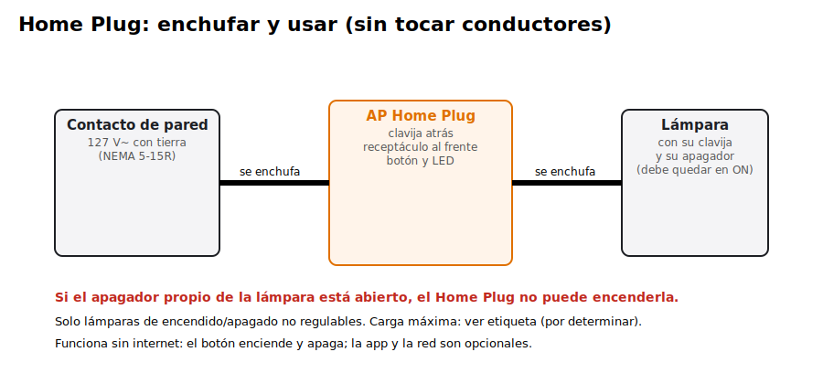
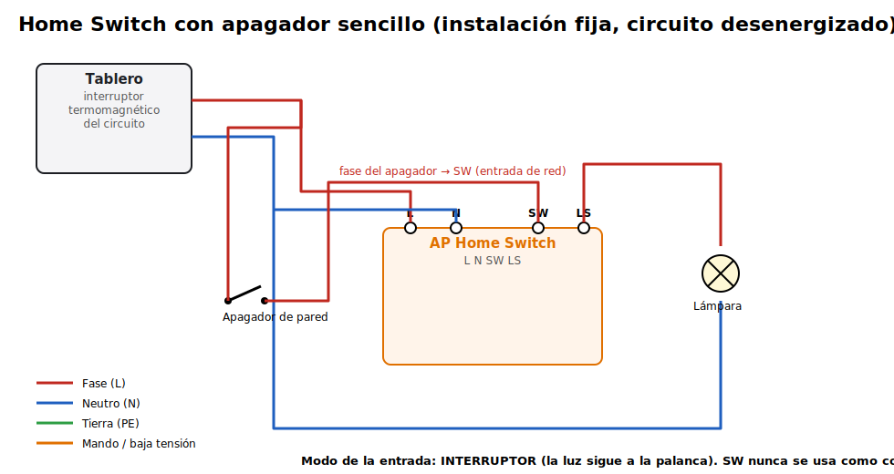
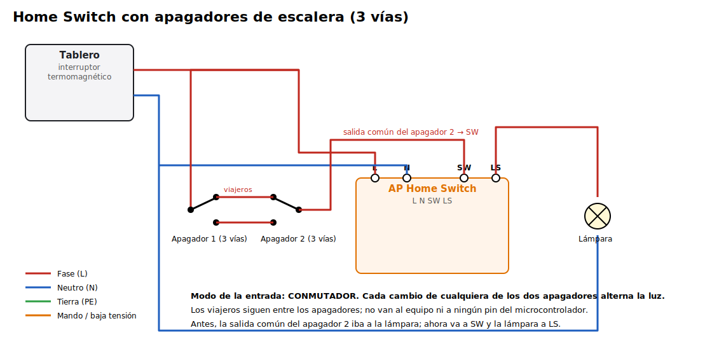
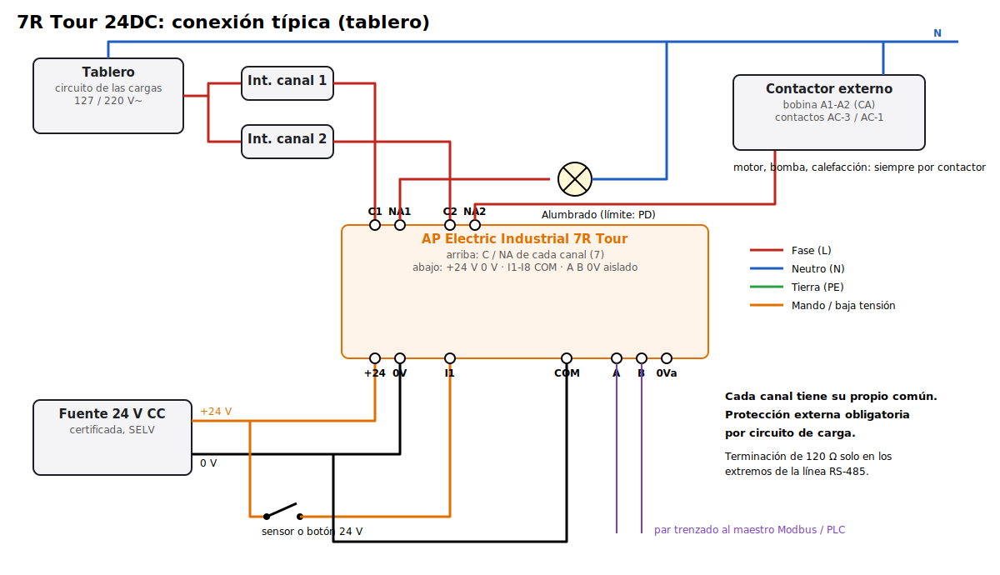

# AP Electric: instrucciones de instalación (preliminares)

> **CONCEPTO / prototipo: no instalar en una vivienda ni en una planta en uso** hasta completar los ensayos de `PLAN_VERIFICACION.md`. La instalación debe cumplir la NOM-001-SEDE vigente.

## Home Plug (enchufar y usar)

1. Enchufa el Home Plug en un contacto de 127 V con tierra.
2. Enchufa la lámpara en el receptáculo del Home Plug.
3. Deja el apagador propio de la lámpara en **encendido**. Si queda abierto, el Home Plug no puede encenderla.
4. El botón enciende y apaga. LED verde = encendido; LED rojo = falla.

Solo lámparas de encendido/apagado, **no regulables**, dentro de la carga de la etiqueta. Nada de motores, calefactores ni herramientas.

## Home Switch: requisitos

Instalación **fija**. La hace una persona competente, con el **circuito desenergizado** (interruptor del tablero abierto y verificado sin tensión).

- Se necesita **neutro** en el punto de instalación. Sin neutro: no instalar (no hay SKU para eso).
- Va en una caja de registro o junto a la luminaria. No cabe en la chalupa del apagador.
- Cable con la sección del circuito, protegido por su interruptor termomagnético. La carga no debe pasar el límite de la etiqueta.
- **SW es una entrada de red.** Recibe la fase que regresa del apagador. Nunca se conecta ahí un contacto de baja tensión ni nada que no sea esa fase.

### Con apagador sencillo

| Borne | Va a |
|---|---|
| **L** | Fase |
| **N** | Neutro |
| **SW** | Retorno del apagador (antes iba a la lámpara) |
| **LS** | Lámpara |

Modo de la entrada: **INTERRUPTOR** (orden `E 1 1 1 30`).

### Con apagadores de escalera (3 vías)

- Los dos apagadores y sus viajeros **quedan como estaban**.
- Solo cambia el destino de la salida común del segundo apagador: va a **SW** en vez de a la lámpara, y la lámpara se conecta a **LS**.
- Modo de la entrada: **CONMUTADOR** (orden `E 1 2 1 30`). Cada cambio de cualquier apagador alterna la luz.
- No conectar viajeros al equipo.

### Lo que NO se hace

- Usar el Home Switch sin neutro.
- Pasar corriente por la lámpara para alimentar el equipo.
- Conectar un contacto seco o una señal de baja tensión a SW.
- Prometer que el apagador funcione con el equipo averiado: el apagador **manda una orden**, no hay bypass físico.

## 7R Tour 24DC y 7R Tour CA (tablero)

1. **Montaje.** Riel DIN de 35 mm, dentro de un tablero cerrado; deja espacio de ventilación (PD).
2. **Alimentación.**
   - 7R Tour 24DC: fuente de 24 V CC **certificada** (SELV) a J9 (+24 V, 0 V).
   - 7R Tour CA: L y N de la red a J8, con su protección aguas arriba.
3. **Entradas.**
   - Cada sensor o botón da +24 V a su entrada (I1-I8).
   - El 0 V del circuito de sensores va a **COM**.
4. **Salidas.** Cada canal tiene su propio común.
   - La fase de la carga llega a **C** y sale por **NA**, con un **interruptor termomagnético o fusible por circuito**, dimensionado al cable y al límite del canal (PD).
   - Motores, bombas y resistencias grandes se conectan **siempre por un contactor** externo elegido por categoría de utilización. El 7R Tour solo maneja su bobina, con el supresor que pida el fabricante de la bobina.
5. **RS-485 (AP LINK / Modbus RTU).**
   - Par trenzado a A y B, con la malla a 0V aislado.
   - Terminación de 120 Ω (puente JP1) solo en los dos extremos de la línea.
6. **Primer encendido.** Todas las salidas quedan apagadas.
   - Configura la política de arranque de cada canal (`A k 0|1|2`, `T k 1` para proceso).
   - Configura la vigilancia del maestro Modbus (`MB 1 9600 0 5`).
   - Guarda con `GUARDAR`.
7. **Mando manual (DIP bajo la tapa).**
   - 1-7 encienden su relé directamente.
   - Úsalos solo en pruebas o en mantenimiento y regrésalos a OFF.
   - El 8 apaga el Wi-Fi.

El 7R Tour **no es un equipo de seguridad**. El paro de emergencia y los enclavamientos de protección de personas van en un sistema de seguridad evaluado, aparte.
