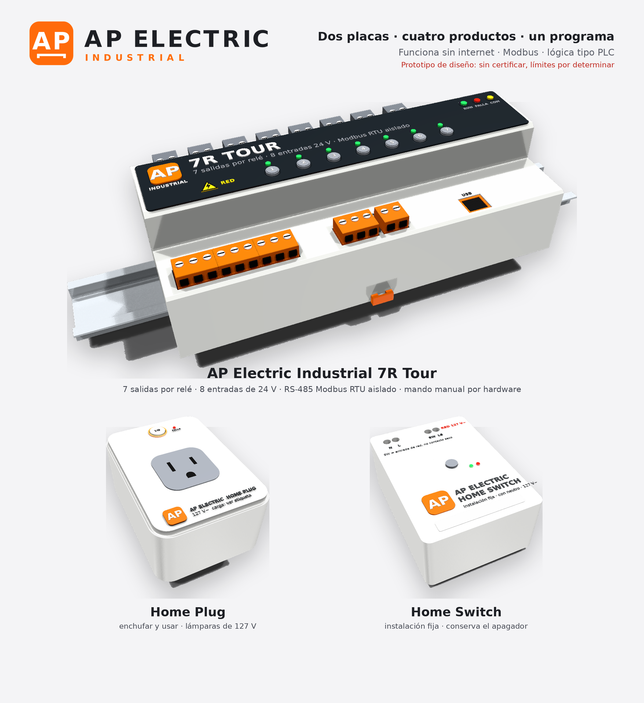

# AP Electric: familia residencial e industrial (rev A, CONCEPTO)

> **Estado de todo lo que hay aquí: CONCEPTO / prototipo de diseño.**
> - **Hecho:** esquemas y placas verificados por software, programa compilado y probado en la PC, identidad, carcasas y documentación.
> - **No hecho:** fabricación, mediciones, ensayos de laboratorio y certificación.
> - Ningún valor del producto está aprobado todavía. No vender ni instalar en uso real hasta completar `PLAN_VERIFICACION.md`.



## Menos módulos, más funciones

**Dos placas → cuatro SKU, un solo programa, conectados entre sí sin nube.**

| Placa | SKU | Qué es |
|---|---|---|
| [AP Home](home/) | **Home Plug** | Enchufar y usar: una lámpara de 127 V. Clavija y receptáculo encerrados |
| | **Home Switch** | Instalación fija con neutro; conserva el apagador sencillo o de escalera |
| [7R Tour](7r-tour/) | **7R Tour 24DC** | Tablero: 7 relés, 8 entradas de 24 V, Modbus RTU aislado, lógica tipo PLC |
| | **7R Tour CA** | El mismo, con la fuente de red certificada en la placa |

Las placas de LED de corriente constante son otra familia, **AP LED**, y no alimentan focos convencionales de 127 V:
- AP FOCO / FOCO 127 / PWM4 / UNO;
- la línea de letreros.

## Contenido

| Archivo | Qué es |
|---|---|
| [ARQUITECTURA.md](ARQUITECTURA.md) | Comparación de arquitectura (placa propia, Arduino Opta, PLC, OpenPLC), matriz de modelos y cargas, decisiones, normas y fuentes consultadas |
| [HOJA_DATOS_7R_TOUR.md](HOJA_DATOS_7R_TOUR.md) · [HOJA_DATOS_HOME_PLUG.md](HOJA_DATOS_HOME_PLUG.md) · [HOJA_DATOS_HOME_SWITCH.md](HOJA_DATOS_HOME_SWITCH.md) | Hojas de datos preliminares por SKU (cada valor con su origen; «PD» = por determinar) |
| [INSTALACION.md](INSTALACION.md) · [instalacion/](instalacion/) | Instrucciones y diagramas por variante: Plug, Switch sencillo, Switch de escalera, 7R Tour |
| [MANUAL_USUARIO.md](MANUAL_USUARIO.md) | Manual breve: uso local, LED, fallas, órdenes, Modbus |
| [PLAN_VERIFICACION.md](PLAN_VERIFICACION.md) | Lo comprobado por software, el banco de prototipo y el laboratorio; pendientes concretos |
| `7r-tour/`, `home/` | Proyectos KiCad 9 (generadores en `gen/`):<br>• esquema;<br>• placa;<br>• `fabricacion/jlcpcb` con Gerbers, taladros, BOM y CPL |
| `firmware/APControl/` | Programa AP Control 1.0 (ESP32-C3, Arduino-ESP32 3.1.1): núcleo portable `ap_control.h`, esclavo Modbus `modbus_esclavo.h`, PLC `logica.h`; pruebas en `firmware/pruebas/` |
| `identidad/` | Isotipo, logotipos AP Electric y AP Electric Industrial, marca 7R Tour y etiquetas de producto: SVG vectorial, PNG y PDF. Sin sellos de certificación |
| `carcasas/` + `../ap1-gabinete/producto/` | Generadores de carcasa (DIN del 7R Tour; Home Plug y Home Switch) y STL de prototipo |
| `renders/` | Imágenes del producto |

## Compilar y probar

```
bash tools/probar_apbus.sh                 # pruebas de AP LÓGICA y AP Control en la PC
bash tools/compilar_esp32.sh apcontrol     # programa para ESP32-C3
bash tools/rutear.sh ap-electric/home AP_HOME
```
