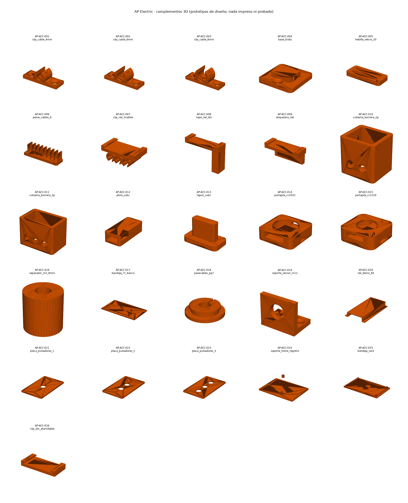

# AP Electric · complementos 3D

Bridas, abrazaderas, anclajes, soportes y modelos de referencia de cables y conectores, en 3D paramétrico (mm).

**Estado: prototipos de diseño.** Nada se ha impreso ni probado con las piezas reales. Las medidas de los componentes comprados
(bornera KF128-5.08, conector y receptáculo USB-C, pilas, prensaestopas, sensores, riel TS35) vienen de dibujos o de conocimiento general
y están marcadas para comprobarse con la pieza en la mano antes de imprimir un lote. Holgura de ajuste supuesta: 0.25 mm por lado (FDM, boquilla de 0.4 mm), sin medir.



## Cómo se regeneran

```
python3 accesorios.py     # stl/, ref/ y catalogo.json
python3 validar.py        # sólidos cerrados, medidas coherentes con las constantes de las piezas compradas
python3 vista_previa.py   # vista_previa.png
```

Requiere `trimesh`, `manifold3d`, `numpy` y `matplotlib`. Cada pieza ya está en su orientación de impresión (base en z = 0);
las de riel DIN se imprimen con las funciones sobre la cama y los ganchos arriba (los dientes son voladizos de 2 mm).

## Piezas imprimibles (`stl/`)

| SKU | Archivo | Función | Material sugerido | Medidas (mm) | Nota |
|---|---|---|---|---|---|
| AP-ACC-001 | `stl/clip_cable_4mm.stl` | Abrazadera omega a tornillo para cable de 4 mm | PETG o ABS | 26.7 × 9.0 × 8.4 | M3 avellanada |
| AP-ACC-002 | `stl/clip_cable_6mm.stl` | Abrazadera omega a tornillo para cable de 6 mm | PETG o ABS | 28.7 × 9.0 × 10.15 | M3 avellanada |
| AP-ACC-003 | `stl/clip_cable_8mm.stl` | Abrazadera omega a tornillo para cable de 8 mm | PETG o ABS | 30.7 × 9.0 × 11.88 | M3 avellanada |
| AP-ACC-004 | `stl/base_brida.stl` | Base para brida de plástico de hasta 4.8 mm de ancho | PETG o ABS | 24.0 × 24.0 × 5.6 | 2 tornillos M3 o cinta de doble cara |
| AP-ACC-005 | `stl/hebilla_velcro_20.stl` | Hebilla de paso para cinta de gancho y felpa de 20 mm | PETG | 28.0 × 12.0 × 3.0 | reusable |
| AP-ACC-006 | `stl/peine_cables_8.stl` | Peine organizador de 8 conductores de hasta 4 mm | PETG o ABS | 54.0 × 16.0 × 14.0 | 2 tornillos M3 |
| AP-ACC-007 | `stl/clip_riel_3cables.stl` | Sujetacables de riel DIN TS35 para 3 cables de 6 mm | PETG o ABS | 41.5 × 22.0 × 15.24 | encaja a presión; verificar el diente con el riel real |
| AP-ACC-008 | `stl/tope_riel_din.stl` | Tope final de riel DIN TS35 con tornillo M4 | PETG o ABS | 41.5 × 12.0 × 29.7 | el tornillo M4 aprieta contra el riel |
| AP-ACC-009 | `stl/etiquetero_riel.stl` | Portaetiquetas de riel DIN (etiqueta de 30 x 12 mm) | PETG | 41.5 × 17.0 × 19.7 | etiqueta de papel o PET en la ranura |
| AP-ACC-010 | `stl/cubierta_bornera_2p.stl` | Cubierta para bornera KF128-5.08 de 2 polos | PETG o ABS | 14.26 × 12.7 × 14.0 | medidas de la bornera por confirmar con la pieza |
| AP-ACC-011 | `stl/cubierta_bornera_3p.stl` | Cubierta para bornera KF128-5.08 de 3 polos | PETG o ABS | 19.34 × 12.7 × 14.0 | medidas de la bornera por confirmar con la pieza |
| AP-ACC-012 | `stl/alivio_usbc.stl` | Alivio de tensión (bota) para cable USB-C | TPU 95A o PETG | 14.0 × 30.0 × 8.0 | se pega al conector con adhesivo flexible |
| AP-ACC-013 | `stl/tapon_usbc.stl` | Tapón antipolvo para el receptáculo USB-C | TPU 95A | 12.44 × 6.76 × 7.6 | ajuste por fricción |
| AP-ACC-014 | `stl/portapila_cr2032.stl` | Portapila CR2032 con canal para el cable del conector de batería | PETG | 25.4 × 25.4 × 7.4 | se sujeta con brida; no es un portapila con contactos |
| AP-ACC-015 | `stl/portapila_cr1220.stl` | Portapila CR1220 con canal para el cable del conector de batería | PETG | 17.9 × 17.9 × 6.2 | se sujeta con brida |
| AP-ACC-016 | `stl/separador_m3_8mm.stl` | Separador M3 de 8 mm con asiento hexagonal | PETG o ABS | 8.0 × 8.0 × 8.0 | para pruebas de banco |
| AP-ACC-017 | `stl/bandeja_7r_banco.stl` | Bandeja de banco para la placa 7R Tour con 4 postes M3 | PETG o ABS | 204.0 × 118.0 × 10.5 | los 4 postes están en los agujeros reales de la placa; no es un gabinete |
| AP-ACC-018 | `stl/pasacables_pg7.stl` | Pasacables flexible para agujero de 12.5 mm y cable de 6 mm | TPU 95A | 17.3 × 17.27 × 4.0 | con rendija para meter el cable |
| AP-ACC-019 | `stl/soporte_sensor_m12.stl` | Escuadra para sensor cilíndrico M12 | PETG o ABS | 30.0 × 22.0 × 26.0 | para M8 usar d = 8 |
| AP-ACC-020 | `stl/riel_demo_60.stl` | Tramo de riel DIN TS35 de 60 mm para pruebas de ajuste | PLA o PETG | 35.0 × 60.0 × 7.5 | no soporta carga: solo para probar el ajuste |
| AP-ACC-021 | `stl/placa_pulsadores_1.stl` | Tapa de pared de chalupa con 1 pulsador de 16 mm y ventana de luz | PETG o ABS | 70.0 × 115.0 × 3.0 | chalupa de 2 x 4 pulgadas; tornillos a 82.55 mm por confirmar |
| AP-ACC-022 | `stl/placa_pulsadores_2.stl` | Tapa de pared de chalupa con 2 pulsadores | PETG o ABS | 70.0 × 115.0 × 3.0 | para Home Switch de varios circuitos (un módulo por pulsador) |
| AP-ACC-023 | `stl/placa_pulsadores_3.stl` | Tapa de pared de chalupa con 3 pulsadores | PETG o ABS | 70.0 × 115.0 × 3.0 | idem |
| AP-ACC-024 | `stl/soporte_home_registro.stl` | Base para fijar la placa AP Home dentro de una caja de registro | PETG o ABS | 95.0 × 87.1 × 8.0 | postes en los agujeros de la placa; no sustituye la caja ni la tapa certificadas |
| AP-ACC-025 | `stl/bandeja_rack.stl` | Bandeja para un módulo AP Rack (176 x 100) con 4 postes M3 y ranuras para clips DIN | PETG o ABS | 192.0 × 116.0 × 10.5 | los postes están en los agujeros de la placa; no es un gabinete |
| AP-ACC-026 | `stl/clip_din_atornillable.stl` | Clip de riel DIN TS35 atornillable (2 x M3) | PETG o ABS | 41.5 × 20.0 × 5.7 | encaje por probar con el riel real |

## Modelos de referencia (`ref/`, solo visuales; .glb con color y .stl)

| SKU | Archivo | Qué es |
|---|---|---|
| AP-REF-001 | `ref/ref_cable_usbc.glb` | Cable USB-C con conector y bota (modelo visual) |
| AP-REF-002 | `ref/ref_cable_sensor_m8.glb` | Cable de sensor con conector M8 de 3 hilos (modelo visual) |
| AP-REF-003 | `ref/ref_cable_24v.glb` | Cable de alimentación de 24 V con punteras (modelo visual) |
| AP-REF-004 | `ref/ref_borne_3p.glb` | Borne enchufable de 3 polos, paso 5.08 (modelo visual) |
| AP-REF-005 | `ref/ref_borne_2p.glb` | Borne enchufable de 2 polos, paso 5.08 (modelo visual) |
| AP-REF-006 | `ref/ref_pila_cr2032.glb` | Pila CR2032 (modelo visual) |
| AP-REF-007 | `ref/ref_cable_aplink.glb` | Cable AP LINK de 4 hilos con conectores JST XH (modelo visual) |

## Lo que falta

- Imprimir una pieza de cada tipo y medir el ajuste real: riel, bornera, USB-C, pila, agujero de panel.
- Confirmar que los 4 postes de la bandeja coinciden con la placa fabricada (coordenadas de `7r-tour/gen/make.py`, Y espejado porque KiCad cuenta hacia abajo).
- Los ganchos de riel DIN son un diseño de enganche inclinado sin probar; si no sujetan, se ajusta el diente o se pasa a un clip con resorte.
- Ninguna pieza es gabinete ni protección eléctrica certificada: la bandeja es solo para pruebas de banco; no usar piezas impresas como aislamiento en red de CA.
