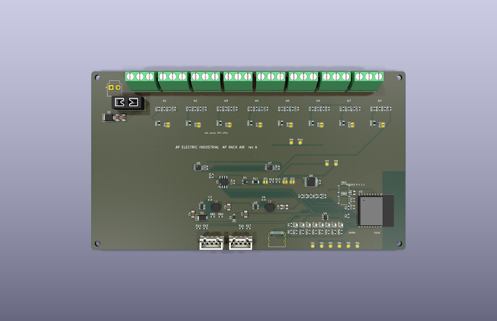

# AP Rack AI8 rev A (CONCEPTO)

Módulo de **8 entradas analógicas** (0-10 V o 4-20 mA por canal) para la cadena [AP LINK](../AP_LINK.md). Misma alimentación (12-30 V CC), ESP32-C3, USB-C, panel de LED y conectores ENTRA/SIGUE que el [AP Rack 16](../rack16/LEEME.md). Se anuncia en la cadena como tipo 3.

> **Estado: CONCEPTO.** Cierra por software (ERC 0, DRC 0, sin pistas sin unir, paridad 0, pedido sin errores). Nada fabricado ni medido.

| | |
|---|---|
| Convertidores | 2 × ADS1115 (I2C 0x48 con ADDR a GND, 0x49 con ADDR a 3V3), 4 canales cada uno |
| Canal | Divisor 22 kΩ / 10 kΩ para 0-10 V; con el puente de soldadura JP4-JP11 cerrado, shunt de 150 Ω (20 mA → 3.0 V) |
| Borneras | 8 × KF128 de 3 polos |
| Tamaño | 176 × 100 mm, 2 capas, 2 oz |
| Piezas | 40 tipos, 121 piezas, todas con código LCSC verificado |

En el PLC ([PLC_RACK.md](../PLC_RACK.md)) los canales se ven como A1-A8 (valor en voltios o miliamperios según el modo del canal).

## Límites

- Con el puente 4-20 mA cerrado **no** conectar una fuente de voltaje al canal.
- La exactitud y el ruido no están medidos; no hay calibración.
- Sin aislamiento de AP LINK ni de las entradas analógicas; sin protección ESD en SENSE (ver [AP_LINK.md](../AP_LINK.md)).
- No es una función de seguridad.
- Falta revisar a mano en JLCPCB la orientación de las piezas polarizadas.

Archivos: `kicad/` · `gen/make.py` (hereda las piezas comunes del Rack 16) · `fabricacion/` · `vistas/`.
