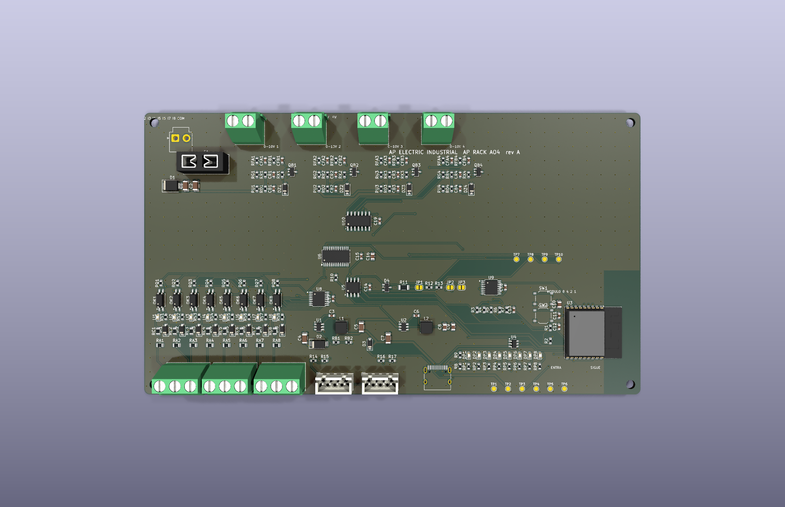

# AP Rack AO4 rev A (CONCEPTO)

Módulo de **4 salidas analógicas de 0 a 10 V** para atenuar luminarias con driver 0-10 V / 1-10 V, variadores de velocidad y otras entradas analógicas, con las mismas 8 entradas de 12-30 V del [AP Rack 16](../rack16/LEEME.md), para la cadena [AP LINK](../AP_LINK.md). Se anuncia en la cadena como tipo 6.

> **Estado: CONCEPTO.** Cierra por software (ERC 0, DRC 0, sin pistas sin unir, paridad 0, pedido sin errores) y el programa pasa sus pruebas en la PC. Nada fabricado ni medido.

| | |
|---|---|
| Salidas | 4 × 0-10 V: PCA9685 (I2C **0x41**, 12 bits, ≈1.5 kHz) → filtro RC de 2 etapas (10 k / 1 µF) → LM324 con ganancia 3 → seguidor PNP (absorbe la corriente de un driver 1-10 V) con pull-up de 22 k, 47 Ω en el lazo y zener de 12 V |
| Nivel | 0-255 desde la consola (`D g v`): 255 ≈ 9.9 V. La salida está en 0 V si no está habilitada (`C g 1` la habilita) |
| Bornas | 4 × KF128 de 2 polos: 1 = 0-10 V, 2 = 0 V |
| Entradas | 8 × LTV-217 de 12-30 V (igual que el Rack 16), TCA9554 0x22 |
| Alimentación | 12-30 V CC; **para llegar a 10 V se necesitan unos 15 V o más** (el LM324 cuelga del +V) |
| Tamaño | 176 × 100 mm, 2 capas, 2 oz |
| Piezas | 49 tipos, 191 piezas, todas con código LCSC verificado |

El circuito de salida es el de la placa [AP LIGHT AO4](../../ap1-ao4/), que se simuló en ngspice; aquí cambia la alimentación (el +V de 12-30 V en lugar de 24 V fijos) y **no se ha simulado de nuevo**.

## Límites

- La escala depende de que el 3.3 V de la placa sea exacto: un error de 3 % en el 3.3 V es un error de 3 % en los 10 V. Sin medir, sin calibración.
- Con 12 V de alimentación el LM324 no llega a 10 V; con 15 V o más sí (por diseño, sin medir).
- Las salidas **no están aisladas** del +V, del 0 V ni del enlace AP LINK. Son SELV: no conectar a nada con tensión de red.
- Un solo driver 0-10 V por salida es el caso de diseño; varios en paralelo suman corriente (unos 10 mA por salida).
- Sin aislamiento de AP LINK ni protección ESD en SENSE (ver [AP_LINK.md](../AP_LINK.md)). No es una función de seguridad.
- Falta revisar a mano en JLCPCB la orientación de las piezas polarizadas.

Archivos: `kicad/` · `gen/make.py` (hereda las piezas comunes del Rack 16) · `fabricacion/` · `vistas/`.
