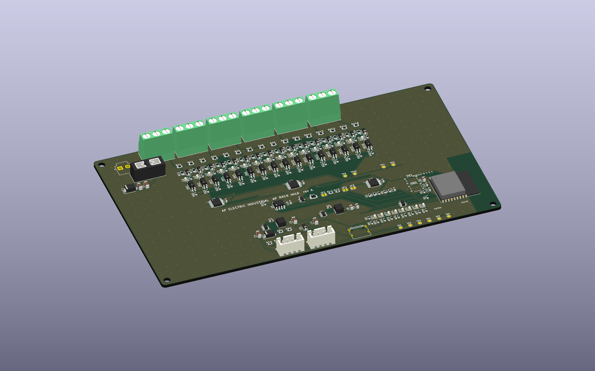

# AP Rack IN16 rev A (CONCEPTO)

Módulo de **16 entradas digitales de 12 a 30 V**, optoaisladas, para la cadena [AP LINK](../AP_LINK.md). Es la placa [AP Rack 16](../rack16/LEEME.md) sin salidas: misma alimentación (12-30 V CC), ESP32-C3, USB-C, panel de LED y conectores ENTRA/SIGUE. Se anuncia en la cadena como tipo 2.

> **Estado: CONCEPTO.** Cierra por software (ERC 0, DRC 0, sin pistas sin unir, paridad 0, pedido sin errores). Nada fabricado ni medido.

| | |
|---|---|
| Entradas | 16 × LTV-217 con 2 × 3.3 kΩ + LED + 2.2 kΩ por canal (circuito del 7R Tour adaptado a 12-30 V); común propio COMI (0 V del sensor); protección contra polaridad invertida |
| Umbral | Meta de diseño: apagada por debajo de ~5 V, encendida desde ~11 V (tipo 1/3 de IEC 61131-2 **como objetivo**, sin medir) |
| Borneras | 6 × KF128 de 3 polos (16 entradas + 2 COMI) |
| Expansores | TCA9554 0x24 (entradas 1-8) y 0x25 (9-16), una sola línea de interrupción compartida |
| Tamaño | 176 × 100 mm, 2 capas, 2 oz |
| Piezas | 41 tipos, 191 piezas, todas con código LCSC verificado; ~36 USD de cargo por 12 tipos Extended (~24 USD con el pedido económico) |

En la cadena, sus entradas se suman a las de los demás módulos: con un Rack 16 al frente, las entradas del IN16 son I9-I24 en el PLC ([PLC_RACK.md](../PLC_RACK.md)).

## Límites

- Una entrada de 12 V da poca corriente al optoacoplador: el margen con CTR bajo no está medido.
- Sin aislamiento de AP LINK ni protección ESD en SENSE (ver [AP_LINK.md](../AP_LINK.md)).
- No es una función de seguridad: no usar para paros de emergencia ni enclavamientos de seguridad.
- Falta revisar a mano en JLCPCB la orientación de las piezas polarizadas.

Archivos: `kicad/` · `gen/make.py` (hereda las piezas comunes del Rack 16) · `fabricacion/` · `vistas/`.
