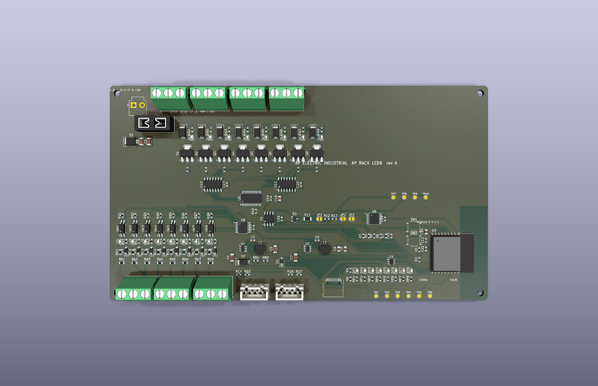

# AP Rack LED8 rev A (CONCEPTO)

Módulo de **8 salidas con brillo (PWM)** para tiras y luminarias LED de 12 a 30 V, con las mismas 8 entradas de 12-30 V del [AP Rack 16](../rack16/LEEME.md), para la cadena [AP LINK](../AP_LINK.md). Se anuncia en la cadena como tipo 4.

> **Estado: CONCEPTO.** Cierra por software (ERC 0, DRC 0, sin pistas sin unir, paridad 0, pedido sin errores) y el programa pasa sus pruebas en la PC. Nada fabricado ni medido.

| | |
|---|---|
| Salidas | 8 × NCV8406A (lado bajo, 65 V, protegido contra corto, sobrecorriente y temperatura), diodo de bobina y LED por salida; la carga va entre +V y la salida |
| Brillo | PCA9685 (I2C 0x40, 12 bits) a 1 kHz, que maneja los 74HCT125 de las compuertas; 0-255 por salida desde la consola (`D g v`) o el panel |
| Entradas | 8 × LTV-217 de 12-30 V (igual que el Rack 16), TCA9554 0x22 |
| Alimentación | 12-30 V CC con fusible mini de 3 A y supresor SMBJ33A |
| Tamaño | 176 × 100 mm, 2 capas, 2 oz |
| Piezas | 46 tipos, 181 piezas, todas con código LCSC verificado |

## Cómo se usa

1. Conecta la tira LED: el **+V** de la tira al +V del bloque y el **−** (cátodo común) a la salida.
2. En la cadena, el módulo aparece con sus 8 salidas Q (siguiendo a los módulos anteriores) y con el control de brillo.
3. `C g 1` enciende, `C g 0` apaga y `D g 128` pone el brillo a la mitad. Con el PLC ([PLC_RACK.md](../PLC_RACK.md)) la salida sigue siendo digital: el programa decide si está encendida y el brillo sigue siendo el que pidió el panel.
4. Si se pierde el enlace, las salidas pasan a la máscara segura (de fábrica, todo apagado) en 1 s.

## Límites

- **Es un regulador de brillo por PWM, no una fuente de corriente constante**: sirve para tiras LED de voltaje fijo (12 o 24 V). Para LED de potencia con corriente constante usa los cabezales [AP FOCO](../../ap1-foco127/).
- La corriente máxima por canal y el calentamiento del NCV8406A **no están medidos**; no hay corriente de diseño garantizada. Las pistas de +V son de 0.8 mm con fusible de 3 A, como en el Rack 16.
- A 1 kHz no se espera parpadeo visible, pero no se ha probado con cámara ni con carga real. Una tira con mucha capacitancia puede disparar la protección del transistor.
- Sin aislamiento de AP LINK ni protección ESD en SENSE (ver [AP_LINK.md](../AP_LINK.md)).
- No es una función de seguridad.
- Falta revisar a mano en JLCPCB la orientación de las piezas polarizadas.

Archivos: `kicad/` · `gen/make.py` (hereda las piezas comunes del Rack 16) · `fabricacion/` · `vistas/`.
