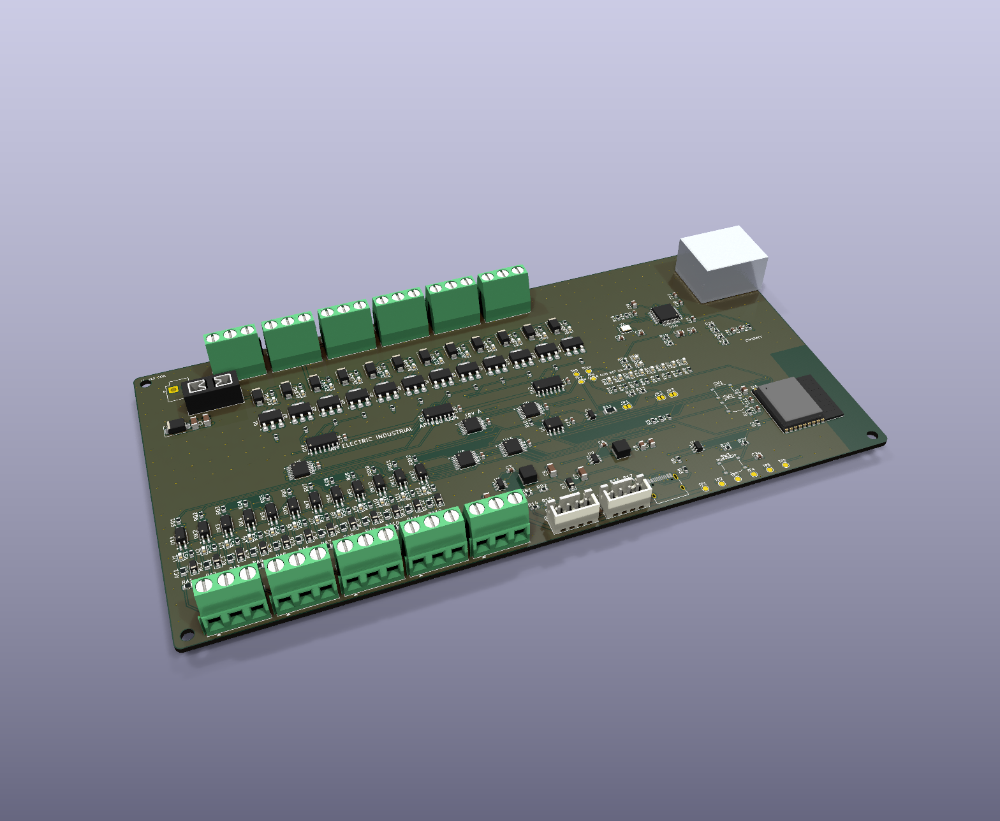

# AP PLC C24 rev A (CONCEPTO)

PLC compacto de **CC** para tablero: **12 entradas, 12 salidas protegidas, Ethernet y AP LINK** en una placa de 200 × 100 mm. Hoja de datos: [HOJA_DATOS_AP_PLC_C24.md](../HOJA_DATOS_AP_PLC_C24.md).

> **Estado: CONCEPTO.** Cierra por software (ERC 0, DRC 0, sin pistas sin unir, paridad esquema/placa 0, pedido a JLCPCB «sin errores»). **Nada está fabricado ni medido.** Sin certificación y sin límites de corriente validados. No es una función de seguridad.

## Qué trae

| | |
|---|---|
| Alimentación | **12 a 30 V CC** por JST VH, fusible mini de auto (de fábrica **3 A**), supresor SMBJ33A, buck de 60 V a 5 V y buck de 2 A a 3.3 V |
| Salidas | **12** de lado bajo: NCV8406A (65 V; protección propia), diodo de bobina SS14 y LED por salida. La carga va **entre +V y la salida**; 6 borneras de 3 polos = salida, +V, salida |
| Entradas | **12** de 12-30 V optoaisladas (LTV-217, mismo circuito que AP Rack 16), común propio COMI; 4 borneras de 3 polos y una de comunes |
| Ethernet | **W5500** por SPI + RJ45 con magnéticos **HR911105A**, cristal de 25 MHz; Modbus TCP en el puerto 502 |
| Enlace | **AP LINK**: ENTRA (libre en el PLC) y SIGUE hacia el primer módulo AP Rack; RS-485 a 250 kbit/s con SENSE. Cerrar JP2 y JP3 (polarización) en el PLC |
| Panel | Energía, enlace Ethernet (los maneja el hardware), RUN, FALLA, COM, NET y 4 LED de usuario (M1-M4 del programa); botón RUN/STOP; MODO y RESET |
| Cerebro | ESP32-C3-WROOM-02 con USB-C |
| Programa | [`firmware/APRack`](../firmware/APRack/APRack.ino) reconoce la placa por los chips I2C (TCA 0x24 y 0x20 = AP PLC C24) |

56 tipos de pieza, 266 piezas, **todas con código LCSC** (`tools/jlcpcb.py`; W5500 C32843, HR911105A C12074 y cristal C331600 confirmados en lcsc.com en octubre de 2026, revisar existencias al pedir). Pedido completo: ver `fabricacion/jlcpcb/RESUMEN_JLCPCB.txt`.

## Mapa de pines del ESP32-C3

IO0 = CS del W5500 (antes medía la tensión de entrada) · IO1/IO3/IO10 = RS-485 (TX, RX, DE) · IO2/IO8 = I2C · IO4 = interrupción de entradas · IO5/IO6 = SENSE de entrada y de salida · IO7 = SCK · IO20 = MISO · IO21 = MOSI · IO9 = MODO · USB = IO18/IO19.

Expansores TCA9554: 0x20 salidas 1-8 · 0x21 salidas 9-12 (P4-P7 sin uso con pull-up) · 0x22 entradas 1-8 · 0x23 LED (P0 RUN, P1 FALLA, P2 COM, P3 NET, P4-P7 usuario) · **0x24 entradas 9-12 (P0-P3) y botón RUN/STOP (P4)**.

## Límites conocidos de esta revisión (rev A)

1. **No hay medición de la tensión de entrada** (no quedan pines): el programa informa 0 V y no avisa de baja o alta tensión.
2. **EXRES1 del W5500** va con 12 kΩ + 390 Ω en serie (12.39 kΩ) porque no se confirmó un código LCSC de 12.4 kΩ en 0603 con existencias. La referencia pide 12.4 kΩ 1 %.
3. **Terminación del Ethernet** (4 × 49.9 Ω a un nodo con 10 nF a 0 V y tomas centrales a 3.3 V) según la referencia de WIZnet recordada de memoria [CG]: **confirmar con el esquema oficial antes de fabricar**.
4. **+V en pistas de 0.8 mm** (igual que AP Rack 16): fusible de 3 A; la corriente total y por salida se mide.
5. Sin reloj con pila; la hora llega por NTP (registros 9-11 de Modbus). Programado y compilado, sin probar con una red real.
6. AP LINK sin aislar; Modbus TCP sin autenticación ni cifrado (red de planta aislada).
7. El RJ45 tiene un modelo 3D propio de cajita (`tools/modelos_propios`): apariencia solamente. Falta revisar a mano la orientación de las piezas polarizadas en JLCPCB.
8. No es una función de seguridad: no sustituye paro de emergencia, guardas ni relés de seguridad.

## Archivos

`kicad/` proyecto KiCad 9 · `gen/make.py` generador · `gen/postruteo.py` (ensancha las pistas finas y rellena planos tras rutear) · `fabricacion/` Gerber, taladros, BOM y CPL.

Regenerar: `bash ../../tools/rutear_rapido.sh ap-electric/plc AP_PLC_C24` y después `python3 gen/postruteo.py` (en el contenedor `kc`, desde `ap-electric/plc`). **Ojo:** volver a correr `gen/make.py` borra el ruteo.
