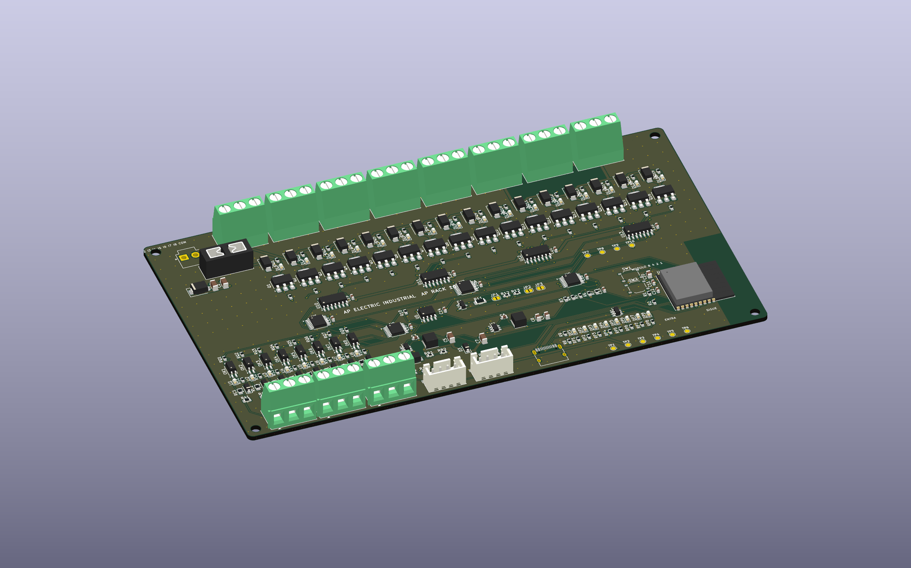

# AP Rack 16 rev A (CONCEPTO)

Placa industrial de **CC** para tablero: **16 salidas protegidas**, 8 entradas y **dos conectores AP LINK** para encadenar más módulos que se reconocen solos. Sin red de CA: las cargas de red se mandan con un contactor o relevador de riel DIN certificado.

> **Estado: CONCEPTO.** Cierra por software (ERC 0, DRC 0, sin pistas sin unir, paridad esquema/placa 0, reglas de JLCPCB 0, pedido sin errores). **Nada está fabricado ni medido.** No hay límites de corriente validados ni certificación.

## Qué es y para quién

| | |
|---|---|
| Segmento | Industrial (tableros de máquinas, electroválvulas, contactores, balizas, bancos de prueba) |
| Alimentación | **12 a 30 V CC** (de diseño: supresor SMBJ33A, buck de 60 V). No solo 24 V: sirve para sistemas de 12 V y de 24 V. Entrada JST VH, fusible mini de auto |
| Salidas | **16** de lado bajo, MOSFET protegido NCV8406A (65 V; protección propia contra cortocircuito, sobrecorriente, temperatura y sobrevoltaje según su hoja), diodo de bobina SS14 y LED por salida. La carga va **entre +V y la salida**; 8 borneras de 3 polos = salida, +V, salida |
| Entradas | **8** de 12-30 V optoaisladas (LTV-217), común propio COMI, LED por entrada |
| Medición | Tensión de entrada (divisor a un ADC), informada por el enlace |
| Enlace | **AP LINK**: 2 × JST XH de 4 patas (ENTRA y SIGUE), RS-485 a 250 kbit/s + línea SENSE. Ver [AP_LINK.md](../AP_LINK.md) |
| Panel | 4 LED de **posición en binario** (1-2-4-8), RUN, FALLA, COM y CABEZA |
| Programa | [`firmware/APRack`](../firmware/APRack/APRack.ino) (ESP32-C3, 51 % de la memoria) con la consola USB y Wi-Fi solo en el cabeza |
| Tamaño | 176 × 100 mm, 2 capas, 2 oz, 4 agujeros M3 |

## Dos módulos o más: cómo se ve

Se conectan con un cable 1 a 1 de SIGUE (módulo 1) a ENTRA (módulo 2). El módulo 1 se vuelve **cabeza**, el 2 queda en la posición 2 (LED de posición 2 encendido, en binario) y en la consola aparecen como «Módulo 1» y «Módulo 2» con **32 salidas seguidas** (la salida 1 del módulo 2 es el canal 17). Probado en el simulador (`prueba_link.cpp`, `prueba_rack.cpp`) y en el navegador (consola con la cadena demo y con el JSON real del programa); **no con placas**.

## Qué hay en la placa

| Bloque | Piezas |
|---|---|
| Potencia | J1 JST VH (hasta 10 A por pata), F1 portafusible mini de auto (de fábrica **3 A**), D1 SMBJ33A, LMR16006 a 5 V, AP63203 a 3.3 V (como el 7R Tour) |
| Salidas | 16 × NCV8406A, 16 × SS14, 4 × 74HCT125 (compuertas a 5 V), 2 × TCA9554 (0x20, 0x21), pull-down de 10 kΩ en cada compuerta (salidas apagadas al arrancar) |
| Entradas | 8 × LTV-217, TCA9554 (0x22, con interrupción) |
| Panel | TCA9554 (0x23) con 8 LED |
| AP LINK | SP3485 sin aislar, SM712, terminación (JP1) y polarización (JP2, JP3) por puentes de soldadura |
| Cerebro | ESP32-C3-WROOM-02, USB-C, botones MODO y RESET, 10 puntos de prueba |

45 tipos de pieza, 230 piezas, **todas con código LCSC verificado** (`tools/jlcpcb.py`). Pedido completo: ~42 USD de cargo por 14 tipos Extended; económico (`_solo_SMD`): ~30 USD y 15 piezas de patas a mano.

## Límites conocidos de esta revisión (rev A)

1. **El +V va en pistas de 0.8 mm** (el ruteador no recibió un tronco de 3 mm): por eso el fusible de fábrica es de **3 A** y no de 10 A. La corriente total y por salida **se mide**; el objetivo de diseño de 2 A por salida y 10 A totales exige un tronco de +V ancho en la rev B.
2. AP LINK **sin aislar** (comparte 0 V por el cable) y sin protección ESD en SENSE; no conectar un cable de AP BUS.
3. Los pines de las patas del SP3485, de las TCA9554 y del ESP32 se revisaron contra el programa (`tools/revisar_pines.py`), pero **ningún dato eléctrico se midió**: umbrales de entrada, caída de las salidas, tiempos del enlace.
4. Falta revisar a mano en JLCPCB la orientación de las piezas polarizadas.
5. No es una función de seguridad: no sustituye paro de emergencia, guardas ni relés de seguridad.

## Archivos

`kicad/` proyecto KiCad 9 · `gen/make.py` generador · `fabricacion/` Gerber, taladros, BOM y CPL · `vistas/` pistas, caras y renders.

Regenerar: `bash ../../tools/rutear.sh ap-electric/rack16 AP_RACK16` (desde `hardware/`; dura varios minutos).
