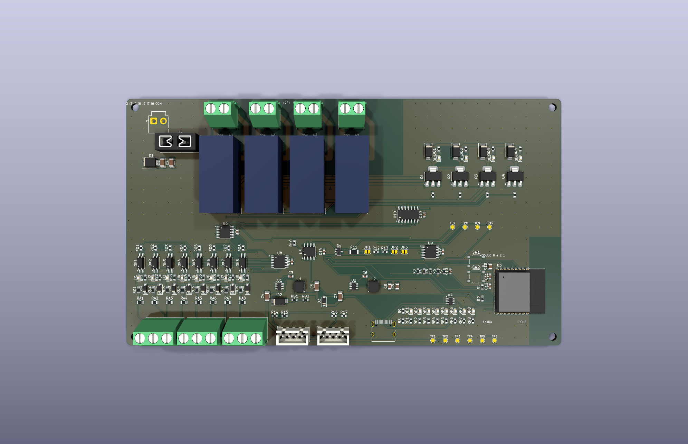

# AP Rack RL4 rev A (CONCEPTO)

Módulo de **4 relés de contacto seco** para la cadena [AP LINK](../AP_LINK.md), con las mismas 8 entradas de 12-30 V del [AP Rack 16](../rack16/LEEME.md). Se anuncia en la cadena como tipo 5 (4 salidas, 8 entradas).

> **Estado: CONCEPTO.** Cierra por software (ERC 0, DRC 0, sin pistas sin unir, paridad 0, pedido sin errores) y el programa pasa sus pruebas en la PC. Nada fabricado ni medido.

| | |
|---|---|
| Relés | 4 × Omron G2RL-1A-E DC24 (bobina 24 V, ≈16.7 mA); cada bobina la maneja una salida protegida NCV8406A con diodo SS14 y LED, como en el Rack 16 |
| Contactos | Un bloque de 2 polos por relé: 1 = común, 2 = normalmente abierto. Pistas de 2.0 mm en las dos caras |
| Entradas | 8 × LTV-217 de 12-30 V (igual que el Rack 16), TCA9554 0x22 |
| Alimentación | **24 V CC** (21.6 a 26.4 V por la bobina del relé), fusible mini de 3 A y supresor SMBJ33A |
| Tamaño | 176 × 100 mm, 2 capas, 2 oz |
| Piezas | 47 tipos, 162 piezas, todas con código LCSC verificado |

El programa lo reconoce solo: tiene el expansor 0x20 pero no el 0x21 del Rack 16. Con un Rack 16 al frente, los relés son Q17-Q20.

## Límites

- El relé tiene 16 A 250 VCA resistivo **según la hoja del fabricante**, pero la placa **no está diseñada ni validada para tensión de red** (sin distancias de aislamiento de red): usar solo cargas de hasta 30 V, como en el piloto del 7R Tour. La corriente por canal en la placa no está medida.
- A 12 V la bobina de 24 V no cierra: el programa avisa si la tensión sale de ≈20-27.5 V.
- Sin aislamiento de AP LINK ni protección ESD en SENSE (ver [AP_LINK.md](../AP_LINK.md)).
- No es una función de seguridad: un relé de esta placa no sustituye un paro de emergencia ni un relé de seguridad.
- Falta revisar a mano en JLCPCB la orientación de las piezas polarizadas.

Archivos: `kicad/` · `gen/make.py` (hereda las piezas comunes del Rack 16) · `fabricacion/` · `vistas/`.
