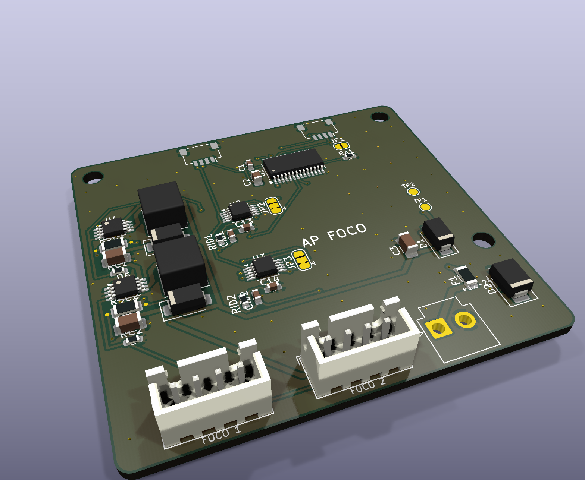

# AP ELECTRIC · Cabezal AP FOCO: 2 focos de corriente constante que se adaptan a cada foco

> Línea **AP LIGHT** del ecosistema [AP ELECTRIC](../AP_ELECTRIC.md). Es un **cabezal**: una placa chica con sus propios chips que se conecta por **Qwiic** al AP UNO, al CORE, a un AP NODE o a un AP GATE. Con 2 cabezales un sistema maneja 4 focos (**L33-L36**).

**Para qué sirve:** focos LED de potencia **sin driver**: reflectores, empotrados, dicroicos de 12-24 V, módulos COB, focos de acuario o vitrinas, letras con LED de 1 W o 3 W en serie. Cada foco recibe **justo la corriente que necesita**, de 25 mA a 1 A, y se atenúa de 0 a 100 % sin parpadeo.

## Cómo se adapta a cada foco

Cada foco trae su **resistencia de ID** (la regla de los drivers "LEDset" de la industria): una resistencia entre la pata 3 (ID) y la pata 4 (0 V) del conector, dentro de la caja del foco o en el mismo cable. El cabezal la mide y **nunca le da más corriente** de la que esa resistencia dice:

**I [mA] = 5000 / R [kΩ]**

| Corriente del foco | Resistencia de ID (1 %) | Ejemplos |
|---|---|---|
| 50 mA | 100 k | Indicadores, tiras chicas en serie |
| 100 mA | 49.9 k | |
| 150 mA | 33.2 k | |
| 200 mA | 24.9 k | |
| 250 mA | 20 k | |
| 300 mA | 16.5 k | |
| **350 mA** | **14.3 k** | LED de 1 W en serie (el más común) |
| 500 mA | 10 k | |
| **700 mA** | **7.15 k** | LED de 3 W, COB chicos |
| **1000 mA** | **4.99 k** | COB de 20 W, reflectores |
| Sin resistencia | (abierto) | **350 mA**: lo que aguanta cualquier foco de potencia |
| En corto | 0 Ω | No enciende y avisa "ID en corto" |

Además:
- **Mide la corriente real** de cada foco (INA238 en la resistencia de 0.1 Ω del driver, con sensado Kelvin: la corriente del foco no pasa por las pistas que se miden) y corrige el ciclo ±20 % para que llegue exacta.
- **Avisa** en la app y en Home Assistant: sin foco o cable abierto, sobrecorriente (se apaga solo), ID en corto, o "la fuente no alcanza la tensión del foco".
- **Límite del usuario:** `FI 1 300` baja el foco 1 a 300 mA aunque su ID diga más (nunca se puede subir más que el ID).

## Conectores

| Conector | Tipo | Qué se conecta |
|---|---|---|
| **J3** ENTRADA | JST VH 2: 1 = +12-24 V, 2 = 0 V | La fuente de los focos (ver "Alimentación") |
| **J4** FOCO 1 / **J5** FOCO 2 | JST XH 4 | 1 = **LED +**, 2 = **LED −**, 3 = **ID**, 4 = **0 V** del ID |
| J1 / J2 | Qwiic | Bus I2C del AP UNO o del CORE / al siguiente módulo |

**Importante:** el LED − **no es 0 V**. El driver es un reductor (buck) y los dos cables del foco quedan cerca del +V. No unas el LED − a la carcasa, al chasis ni al 0 V. La pata 4 (0 V) solo es para la resistencia de ID.

## Límites

| | |
|---|---|
| Entrada | 12-24 V DC (supresor SMBJ26A, fusible de 3 A, protección contra polaridad invertida) |
| Por foco | 25 mA - **1 A** (RSC = 0.1 Ω; el máximo lo pone el ID) |
| Tensión del foco | Hasta la de la fuente **menos 2 V**: con 24 V, focos de hasta 22 V (6-7 LED blancos en serie) |
| Potencia | Hasta 22 W por foco, 44 W por cabezal |
| Atenuación | PWM de 1 kHz en la pata CTRL del AL8860, 12 bits, con curva para el ojo |
| Direcciones | Cabezal 1: PCA9685 **0x60**, INA238 0x4C / 0x4D. Cabezal 2: cerrar **JP1** (0x61) y pasar **JP2** y **JP3** a 2-3 (0x4E / 0x4F) |

## Alimentación: 127 V, 220 V o industrial (277 / 480 V)

La red **no entra a esta placa**: no hay tensión peligrosa en las patas de los LED ni en lo que se toca. Si quieres conectar directo a 127/220 VCA sin fuente aparte, está el **[AP FOCO 127](../ap1-foco127/LEEME.md)** (fuente Mean Well certificada en la misma placa, 2 × 500 mA). Con este cabezal, la tensión de la instalación la convierte una **fuente certificada** de 24 V DC, elegida según el lugar:

| Instalación | Fuente sugerida (24 V) | Notas |
|---|---|---|
| Casa / comercio 127 V | Mean Well **LRS-100-24** (gabinete) o **HDR-100-24** (riel DIN) | 85-264 V AC: sirve igual en 127 y 220 V |
| Exterior, letreros | Mean Well **HLG-100H-24** (IP67) | 90-305 V AC, también para 277 V |
| Industrial 220 / 277 V (fase-neutro) | Mean Well **HDR-150-24** o **SDR-240-24** (riel DIN) | Con interruptor termomagnético propio |
| Industrial 380-480 V (entre fases) | Mean Well **WDR-120-24** o **WDR-240-24** (riel DIN) | 180-550 V AC, 2 fases |

La fuente va en el tablero con su protección (termomagnético o fusible del calibre que pide su hoja de datos) y la instala un electricista. Del lado de 24 V todo es de baja tensión.

## Programa (2.1 o posterior)

| Orden | Qué hace |
|---|---|
| `LU 33 60` | Foco 1 del cabezal 1 al 60 % (L33 = foco 1, L34 = foco 2; cabezal 2: L35, L36) |
| `LO 33 1` / `LO 33 0` / `LO 33 2` | Encender, apagar, alternar |
| `LS 33 1` | El foco sigue a la luz principal (horarios, "solo de noche", escenas) |
| `FI 1 300` | Límite de 300 mA en el foco 1 (`FI 1 0` = el que dice su ID) |
| `ET L33 Vitrina` | Nombre en la app y en Home Assistant |

- En la app (tarjeta **Luminarias**) cada foco muestra la corriente medida, la máxima según su ID y su estado.
- Horarios, entradas, umbrales y horario solar: acciones 9/10/11 con el número 33-36.
- Al encender o reiniciar todo queda apagado: el PCA9685 arranca en 0 y cada CTRL tiene 2.2 k a 0 V.

## Pedir en JLCPCB

- **2 capas**, 1.6 mm, 1 oz, 60 × 56 mm. Archivos en `PEDIDO_JLCPCB/17_AP_FOCO`.
- Todas las piezas traen código LCSC (AL8860MP, INA238, PCA9685PW C2678753, bobinas FNR6045S de 47 µH).
- Los conectores VH y XH se pueden pedir montados o soldar a mano.
- Soporte DIN: `ap1-gabinete/din/soporte_din_60x56.stl`.

## Pruebas antes de instalar

1. Fuente de 24 V **limitada a 0.5 A**, sin Qwiic ni focos: no se calienta nada; en TP1 hay 24 V.
2. Qwiic al AP UNO: la consola dice `AP LIGHT: 1xx` y la app muestra L33 y L34 "sin foco".
3. Un foco de prueba de 350 mA con su resistencia de **14.3 k** en J4: la app dice "350 mA máx.". `LU 33 100`: mide 340-360 mA.
4. Quita la resistencia de ID: sigue en 350 mA ("sin resistencia de ID"). Ponla en corto: el foco se apaga y avisa.
5. **Carga real:** 1 A en los dos focos por 30 min. El AL8860 y la bobina deben quedar a menos de 70 °C.
