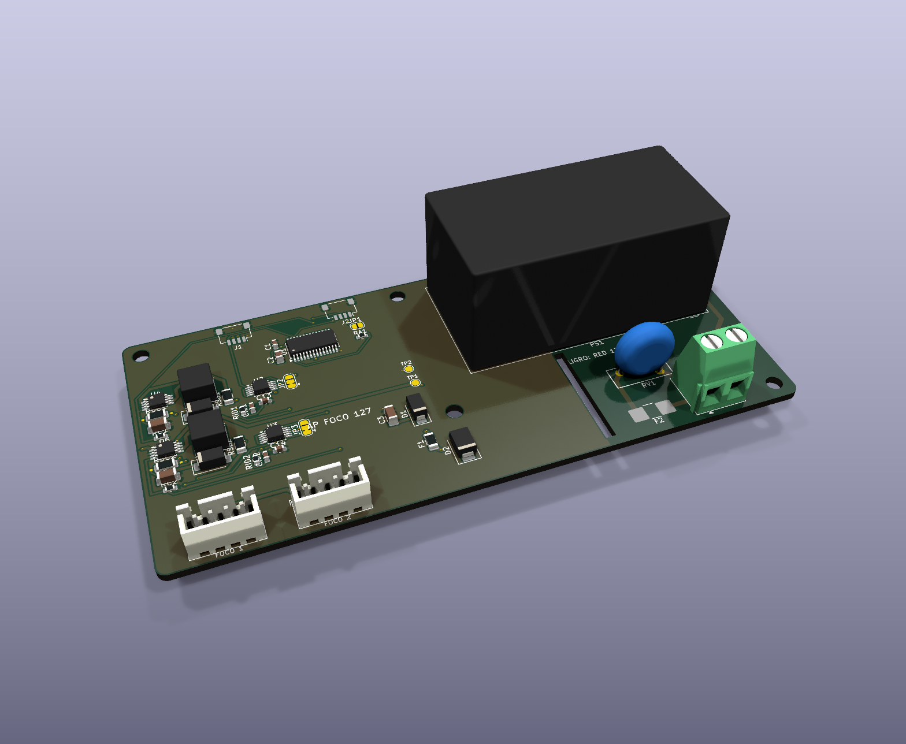

# AP ELECTRIC · AP FOCO 127: el cabezal de focos que se conecta directo a 127/220 VCA

> El [AP FOCO](../ap1-foco/LEEME.md) con su propia fuente de red certificada. Mismos focos con resistencia de ID, la misma corriente medida y los mismos avisos, sin fuente externa. Ecosistema: [AP ELECTRIC](../AP_ELECTRIC.md).

## Qué cambia frente al AP FOCO

| | AP FOCO | **AP FOCO 127** |
|---|---|---|
| Alimentación | 12-24 V DC de una fuente aparte | **127 o 220 VCA** directo (85-264 VCA) |
| Fuente | — | **Mean Well IRM-20-24** encapsulada: 24 V 0.9 A, aislamiento 3 kVCA, certificada por el fabricante |
| Corriente máxima por foco | 1 A | **500 mA** (0.2 Ω: dos resistencias de 0.1 Ω en serie) |
| Potencia total | hasta 44 W | **hasta 20 W** (2 × 500 mA × 20 V): siempre cabe en la fuente, aunque la resistencia de ID del foco pida más |
| Dirección | PCA9685 0x60 / 0x61 | **0x64 / 0x65** (el programa reconoce la versión de red y su tope de 500 mA) |
| Medida | 60 × 56 mm | 120 × 56 mm |

## Seguridad de la parte de red

- La red **solo toca** la bornera KF128, el fusible de retardo de 2 A 250 VCA, el varistor 10D471K y las dos patas de entrada de la fuente. Todo eso está en el lado derecho de la placa (x > 86 mm).
- Las patas de red de la fuente están a **45 mm** de sus patas de 24 V.
- En la zona de red **no hay relleno de cobre**. Entre la red y la baja tensión hay una **ranura fresada**.
- El DRC comprueba **6 mm en el aire y 6.4 mm por la superficie** entre la red y cualquier otro cobre (aislamiento reforzado para 250 VCA).
- Las salidas de los focos, el Qwiic y todo lo que se conecta al AP UNO quedan del lado de 24 V, aislados por la fuente certificada.
- **Va dentro de una caja cerrada.** La bornera de red no se toca con la caja puesta.
- Lo instala un electricista, con un **interruptor termomagnético** (o fusible) en la línea.
- Esta placa no está certificada como producto: la que está certificada es la fuente. Para vender el equipo terminado hay que certificar el conjunto.

## Conectores

| Conector | Qué se conecta |
|---|---|
| **J6** (bornera, tornillo) | **L** (fase) y **N** (neutro) de 127 o 220 VCA. Cable de 0.75-1.5 mm² |
| **J4 / J5** JST XH 4 | Focos 1 y 2: 1 = LED +, 2 = LED −, 3 = ID (resistencia a 0 V), 4 = 0 V |
| J1 / J2 Qwiic | Al AP UNO / CORE y al siguiente módulo |

La tabla de resistencias de ID es la del [AP FOCO](../ap1-foco/LEEME.md#cómo-se-adapta-a-cada-foco), con tope de 500 mA. Por ejemplo, 14.3 k da 350 mA; con 7.15 k o 4.99 k el cabezal entrega 500 mA.

## Pedir

- 2 capas, 1.6 mm, 1 oz, 120 × 56 mm, **con la ranura** (está en la capa de contorno). Archivos en `PEDIDO_JLCPCB/18_AP_FOCO127`.
- Códigos LCSC:

| Pieza | Código |
|---|---|
| IRM-20-24 | C194964 |
| Fusible prosemi 2410LC-2A | C2838939 |
| Varistor 10D471K | C317795 |
| Bornera KF128-5.08-2P | C474952 |

- La fuente y la bornera son de montaje THT: pídelas en el ensamble completo o suéldalas a mano.

## Pruebas (sin red primero)

1. **Sin red:** con el multímetro, entre L o N y cualquier pata del Qwiic: **abierto** (más de 100 MΩ si tienes medidor de aislamiento a 500 V).
2. Con un **foco de prueba de 230 V 25 W en serie** con la línea (limita la corriente si algo está mal), conecta la red: en TP1 hay 24 V.
3. Quita el foco en serie, conecta el Qwiic al AP UNO: en la app aparecen **Foco 1 y Foco 2 · AP FOCO 127** con tope de 500 mA.
4. Un foco con su resistencia de ID de 14.3 k: `LU 33 100` → 340-360 mA.
