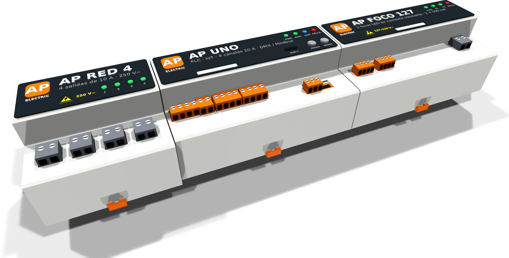

# AP ELECTRIC · el producto terminado: carcasa DIN con logo AP



Cada producto lleva una **carcasa de tablero para riel DIN TS35**. Se genera **a partir de su placa**: la posición de cada conector sale del archivo de KiCad, así que la carcasa siempre coincide con la placa.

| | AP UNO | AP FOCO 127 | AP RED 4 |
|---|---|---|---|
| Medidas (ancho × alto × fondo) | 125 × 90 × 55 mm | 125 × 90 × 55 mm | 78 × 94 × 55 mm |
| Enchufes de tornillo | 10 + AP LINK | 2 + red (L, N) + 2 AP LINK | 1 + 4 de red + 2 AP LINK |

## Cómo es

- **Perfil escalonado de tablero:**
  - hombros a 27 mm de la placa, con los **enchufes de tornillo** justo encima de cada conector;
  - frente central de 36 mm con el **panel antracita**.
- **Frente:**
  - el **logo AP** en relieve (cuadro naranja, letras blancas) y «ELECTRIC»;
  - el nombre y los datos del producto;
  - **LED** de PWR, RUN, red o salidas, y FALLA;
  - botones MODO / RESET y USB-C (AP UNO);
  - una franja blanca para escribir el circuito.
- **Red de 127/220 V:**
  - enchufes **grises** (los de baja tensión son naranjas);
  - **triángulo amarillo** de tensión peligrosa en el frente.
- **Montaje y ventilación:**
  - ranura para el riel en la espalda y **traba naranja** abajo;
  - nervaduras de ventilación en los lados.

## Archivos

| Archivo | Qué es |
|---|---|
| `carcasa.py` | Generador. Escribe:<br>• el modelo con colores (VRML, para KiCad);<br>• el cuerpo en STL;<br>• la escena de la familia en el riel. |
| `extraer.py` | Corre en KiCad (pcbnew). Saca los conectores de cada placa a `placas.json`. |
| `montar.py` | Pone la carcasa como modelo 3D sobre una copia de la placa, para el render de KiCad. |
| `componer.py` | La imagen del producto terminado (`../../AP_ELECTRIC_producto_final.png`). |
| `stl/*_cuerpo.stl` | El cuerpo de cada carcasa, de una pieza, para imprimir un prototipo en PETG o ASA. |
| `renders/` | Los renders: AP UNO, AP RED 4, AP FOCO 127 y la familia. |

```
docker exec kc python3 /work/hardware/ap1-gabinete/producto/extraer.py      # -> placas.json
python3 carcasa.py placas.json SALIDA
python3 montar.py ../../ap1-uno/kicad/AP_UNO.kicad_pcb uno.kicad_pcb SALIDA/caja_uno.wrl SALIDA/riel_uno.wrl
kicad-cli pcb render --quality high --perspective --rotate '-48,0,28' --zoom 0.8 -o uno.png uno.kicad_pcb
```

## Antes de fabricar en serie

- **Prototipo impreso:** el STL es de una pieza, para revisar medidas y el ajuste al riel. Para producción se divide en:
  - base;
  - tapa con el frente;
  - traba;
  y se pasa a molde (policarbonato o PA66 V-0, autoextinguible).
- **Enchufes:** los dibujados son de paso 5.08 / 3.96 / 2.5 mm. En el producto final se cambian los JST de la placa por **cabezales de enchufe de tornillo** (tipo 15EDG) del mismo paso, con código LCSC verificado.
- **Productos de red:** la carcasa cerrada es parte del aislamiento. Hay que comprobar:
  - las distancias de la red al frente;
  - que no se alcancen los bornes con el dedo de prueba;
  - la prueba de hilo incandescente del plástico.
