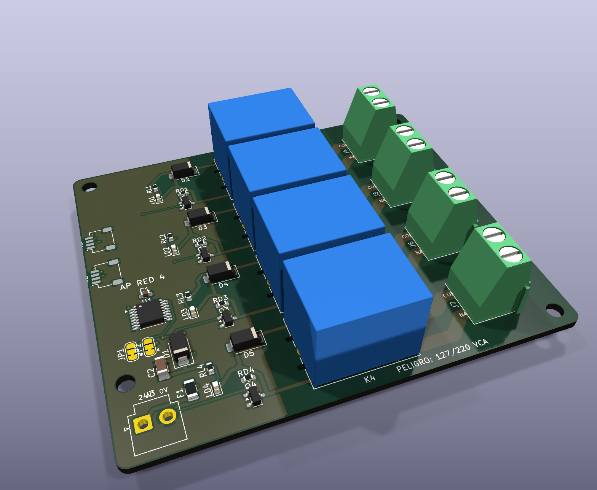

# AP ELECTRIC · AP RED 4: 4 cargas de 127/220 VCA desde la app

> 4 relevadores de 10 A para encender focos, contactos, bombas chicas, calentadores o letreros de red con horarios, entradas, umbrales y la app. Se maneja igual que un DO8, así que el programa 2.1 ya lo usa sin cambios. Ecosistema: [AP ELECTRIC](../AP_ELECTRIC.md).



## Qué trae

| | |
|---|---|
| Relevadores | 4 × Songle **SRD-24VDC-SL-C** (C15840): **10 A 250 VCA** resistivos, bobina de 24 V |
| Por canal | MOSFET AO3400A, diodo de la bobina, LED de encendido y resistencia que lo deja apagado al arrancar |
| Borneras | Una **KF128 de 2 tornillos por carga**: COM (fase que llega) y NA (fase a la carga) |
| Mando | Qwiic, expansor **TCA9554 en 0x21** (JP1/JP2: 0x20-0x23). En la app y en Home Assistant son las salidas **S9-S12** |
| Bobinas | 24 V DC por JST VH 2 (por ejemplo del J3 +V del AP UNO); consumo 4 × 19 mA |

## Cómo se conecta una carga

```
 Termomagnético ── L ──► COM (bornera del canal)
                         NA ──► foco / contacto / bomba ──► N
```

Cada canal es un **contacto seco**: interrumpe la fase de su carga. Cada carga puede venir de un circuito distinto.

## Límites

| Carga | Máximo por canal |
|---|---|
| Resistiva (focos incandescentes, calentadores) | 10 A a 127 VCA / 250 VCA |
| Focos LED y fuentes conmutadas (pico de arranque) | 3 A (~350 W a 127 V) |
| Motores (bombas, ventiladores) | 1/4 HP a 127 V. Más grandes: el relevador manda la bobina de un **contactor** |

Para cargas más grandes, motores trifásicos o alumbrado público, el relevador manda un contactor de riel DIN certificado ([ACTUADORES_DE_POTENCIA.md](../ACTUADORES_DE_POTENCIA.md)).

## Seguridad

- La red solo está a la derecha de x = 30 mm: patas COM, NA y NC de los relevadores, pistas y borneras. Allí **no hay relleno de cobre**.
- Las pistas de red son de **2.5 mm en las dos caras** de una placa de 2 oz.
- Cada pata COM está entre **dos ranuras fresadas** que la separan de las patas de la bobina.
- El DRC comprueba **3 mm en el aire y 5 mm por la superficie** entre la red y la baja tensión.
- El relevador da **aislamiento básico** (1500 VCA entre bobina y contacto). Por eso la placa va **en una caja cerrada**, el lado de 24 V no queda al alcance, y la instala un electricista con un termomagnético por carga.

## Programa

| Orden | Qué hace |
|---|---|
| `SA 9 1` / `SA 9 0` / `SA 9 2` | Canal 1 encender / apagar / alternar (canales 2-4 = S10-S12) |
| `ET S9 Focos patio` | Nombre en la app y en Home Assistant |
| `EA 1 7 9` | La entrada E1 alterna el canal 1 |
| `A 0 127 19 0 5 9` | Todos los días a las 19:00 enciende el canal 1 |
| `SOL 0 0 0 5 9` | Al ocaso enciende el canal 1 |

Al arrancar o si se pierde el Qwiic, los 4 relevadores quedan **apagados**.

## Pedir

- 2 capas, **2 oz**, 1.6 mm, 84 × 73 mm, con las ranuras. Archivos en `PEDIDO_JLCPCB/19_AP_RED4`.
- Relevadores y borneras son THT: ensamble completo o soldar a mano.
- Pruebas: sin red, `SA 9 1` hace sonar el relevador 1 y prende su LED. Con el multímetro en continuidad, COM-NA se cierra. Después prueba la carga con la red.
