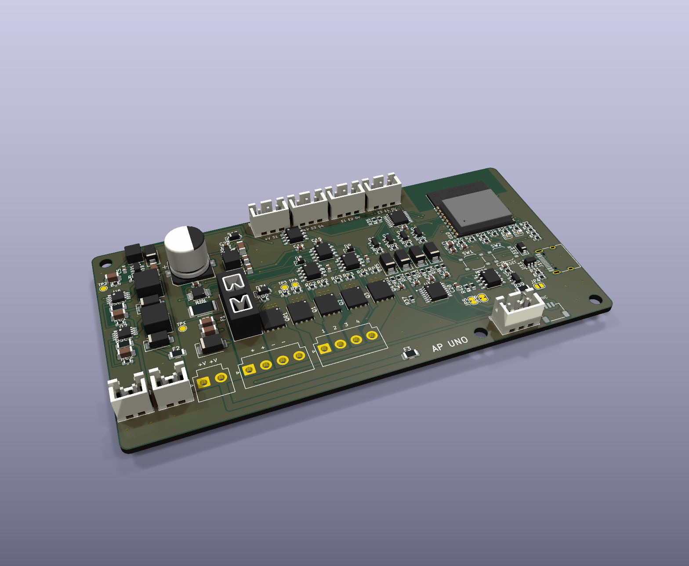

# AP ELECTRIC · AP UNO: el módulo todo en uno

> Una sola placa de **120 × 62 mm** (4 capas) con lo que antes eran 3 o 4 módulos: la potencia de la BASE, el cerebro del CORE, salidas para contactores, entradas, RS-485 (DMX o Modbus) y Qwiic para **cabezales**. Va en el riel DIN o en la caja del letrero. Ecosistema: [AP ELECTRIC](../AP_ELECTRIC.md).

## Qué trae

| Bloque | Qué hace |
|---|---|
| **Potencia** (la de la BASE, misma ubicación, ya probada) | Entrada 12-24 V hasta 20 A con fusible mini, polaridad invertida sin pérdidas, supresor, medidor INA238 (V, A, W, kWh), **4 canales de 8 A** atenuables, **2 focos de corriente constante** (1 A), temperatura y corte por hardware a sobrecorriente, sobrevoltaje y 85 °C |
| **Cerebro** | ESP32-C3 con Wi-Fi y Bluetooth, USB-C para programar, botones MODO y RESET, LED de estado y LED rojo de falla |
| **4 salidas** S1-S4 | 12-24 V para bobinas de contactor, relevadores, válvulas y sirenas (MOSFET + diodo por salida, fusible común de 3 A) |
| **4 entradas** E1-E4 | Contacto seco: pulsadores, apagadores, flotadores, sensores de movimiento con salida a 0 V; con filtro y protección |
| **RS-485** | **DMX512** a reflectores, barras y cabezales DMX, **o** **Modbus RTU** a medidores, variadores y PLC. Terminación de 120 Ω por puente, polarización incluida, protección SM712 |
| **Qwiic** | **Cabezales y módulos**: AP FOCO, PWM4, AO4, DO8, AP INPUT, AI4, DIST 4 |

## Conectores

| Conector | Tipo | Qué se conecta |
|---|---|---|
| **J1** ENTRADA | JST VH 4: 1-2 = +, 3-4 = − | Fuente de 12-24 V DC, hasta 20 A |
| **J3** +V | JST VH 2 | Positivo común de tiras y letreros |
| **J4** CH1-CH4 | JST VH 4 | Negativo conmutado de cada canal, 8 A cada uno |
| **J5 / J8** FOCO 1 / 2 | JST XH 2: 1 = +, 2 = − | Focos de corriente constante, 1 A |
| **J12** S1-S2, **J13** S3-S4 | JST XH 3: 1 = +V, 2 y 3 = salidas | Bobina entre +V y la salida |
| **J14** E1-E2, **J15** E3-E4 | JST XH 3: 1 y 2 = entradas, 3 = 0 V | Contacto entre la entrada y 0 V |
| **J16** RS-485 | JST XH 3: 1 = 0 V, 2 = B (−), 3 = A (+) | El mismo orden del XLR de DMX (1, 2, 3) |
| **J11** | Qwiic | Cabezales y módulos |
| **J10** | USB-C | Programar y probar (el USB solo no enciende las salidas de potencia) |

## Cabezales: cada salida con sus propios chips

El AP UNO no trata de hacerlo todo en la placa: los trabajos especiales van en **cabezales** que se conectan por Qwiic y que el programa reconoce solo:

| Cabezal | Qué hace | Luminarias |
|---|---|---|
| **AP FOCO** ([ap1-foco](../ap1-foco/LEEME.md)) | 2 focos de corriente constante que **se adaptan a cada foco** por su resistencia de ID (25 mA - 1 A), con corriente medida y avisos | L33-L36 |
| **PWM4** ([ap1-pwm4](../ap1-pwm4/LEEME.md)) | 4 canales de 6 A aislados, 12-24 V | L1-L16 |
| **AO4** ([ap1-ao4](../ap1-ao4/LEEME.md)) | 4 circuitos 0-10 V + contactor, para luminarias de 127-480 V con driver atenuable | L17-L32 |
| **DO8 / AP INPUT / AI4** | 8 salidas de 24 V protegidas / 8 entradas aisladas / 4 entradas 0-10 V o 4-20 mA | — |
| **Equipos DMX** | Por el RS-485: reflectores RGB, cabezas móviles, barras, atenuadores DMX de 127-220 V certificados | Equipos 1-170 |

**Direcciones:** el AP UNO usa 0x20 (salidas) y 0x24 (entradas) en la placa. Un DO8 extra va en **0x21** o más, y un AP INPUT extra en **0x25** o más.

## Cargas de 127 V, 220 V o industriales

La red **no entra a la placa**. Para cargas de la instalación:
- **Bobinas de contactor de 24 V** en S1-S4 (contactor DIN certificado del calibre de la carga), o
- **Relevadores de estado sólido** con entrada de 3-32 V DC, o
- **Variadores y medidores** por Modbus en el RS-485, o
- **Luminarias de red con driver 0-10 V** con el cabezal AO4.

La guía completa está en [ACTUADORES_DE_POTENCIA.md](../ACTUADORES_DE_POTENCIA.md). La fuente de 24 V DC es certificada y se elige según la instalación (127 / 220 / 277 / 480 V); hay una tabla en el [LEEME del AP FOCO](../ap1-foco/LEEME.md#alimentación-127-v-220-v-o-industrial-277--480-v).

## Programa (2.1 o posterior)

El programa reconoce la placa sola: en el expansor 0x20 lee **P5 = 0 y P6 = 1** y graba "LL-UNO" en la memoria. Es el mismo programa de todo el ecosistema.

| Orden | Qué hace |
|---|---|
| `DMX 1` | El RS-485 manda **DMX512** (30 cuadros/s). Los 4 canales y los focos siguen funcionando |
| `PX 8` / `PD 1 3` / `PO 1` | 8 equipos DMX, desde la dirección 1, de 3 canales (RGB), orden RGB |
| `MB 9600 0` | El RS-485 pasa a **Modbus RTU** (9600, sin paridad); los puntos se ponen con `MP` como en el AP GATE |
| `MB 0` | RS-485 libre |
| Salidas, entradas, reglas | Igual que con un DO8 y un AP INPUT: S1-S4 y E1-E4 |

En la app aparece la tarjeta **AP UNO: puerto RS-485** con los botones DMX512 / Modbus / Libre.

## Pedir en JLCPCB

- **4 capas**, 1.6 mm, 2 oz exteriores, 120 × 62 mm. Archivos en `PEDIDO_JLCPCB/16_AP_UNO`.
- Todas las piezas traen código LCSC. El portafusibles mini, los VH y los XH se pueden soldar a mano en el pedido económico.
- Soporte DIN: `ap1-gabinete/din/soporte_din_120x62.stl` (7 módulos DIN).

## Cómo se generó (para modificarla)

- `gen/make.py` toma la potencia del generador de la BASE (mismas piezas y ubicaciones) y agrega el cerebro, las salidas, las entradas y el RS-485. Las uniones que el ruteador no lograba en esta placa tan llena van fijas (`PRE`).
- Ruteo: una pasada de Freerouting, una segunda a partir de la primera y el cierre (`--final 2`). Después `gen/retoques.py` hace las últimas uniones (cada una se prueba con el DRC y solo se queda si no agrega violaciones) y une las islas de GND a los planos internos (`gen/islas_gnd.py`).
- En el AP UNO el foco 1 va a **IO0** y el foco 2 a **IO10** (en el CORE es al revés): así los dos troncos de CTRL no se cruzan. El programa 2.1 lo cambia solo al reconocer la placa.
- Resultado: ERC 0, DRC 0, 0 conexiones pendientes, reglas de JLCPCB 0, todas las piezas con código LCSC.

## Pruebas antes de instalar

1. Solo USB-C: el LED verde parpadea, la consola dice `AP UNO: S1-S4, E1-E4, RS-485 libre`.
2. Fuente de 24 V **limitada a 1 A** en J1: en TP5 hay unos 11.5 V (los 12 V de la potencia menos el diodo), nada se calienta.
3. Un LED con resistencia de 2.2 k entre J12-1 y J12-2: `SA 1 1` lo enciende, `SA 1 0` lo apaga.
4. Un cable entre J14-1 y J14-3: la app marca E1 activa.
5. Con un reflector DMX en J16 (y JP4 cerrado si es el último): `DMX 1`, `PX 1`, `PD 1 3`: el reflector sigue el color de la app.
6. Prueba de salidas de la BASE (`DIAG`) y carga real como en la BASE.
