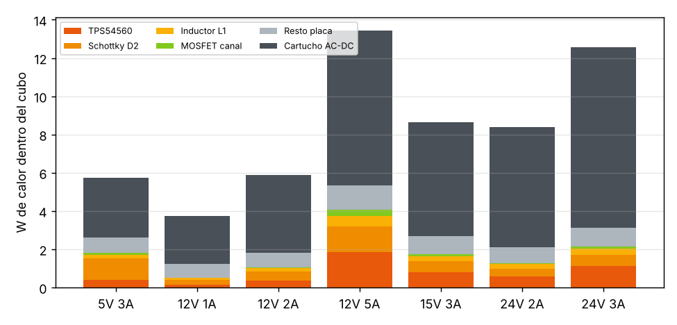
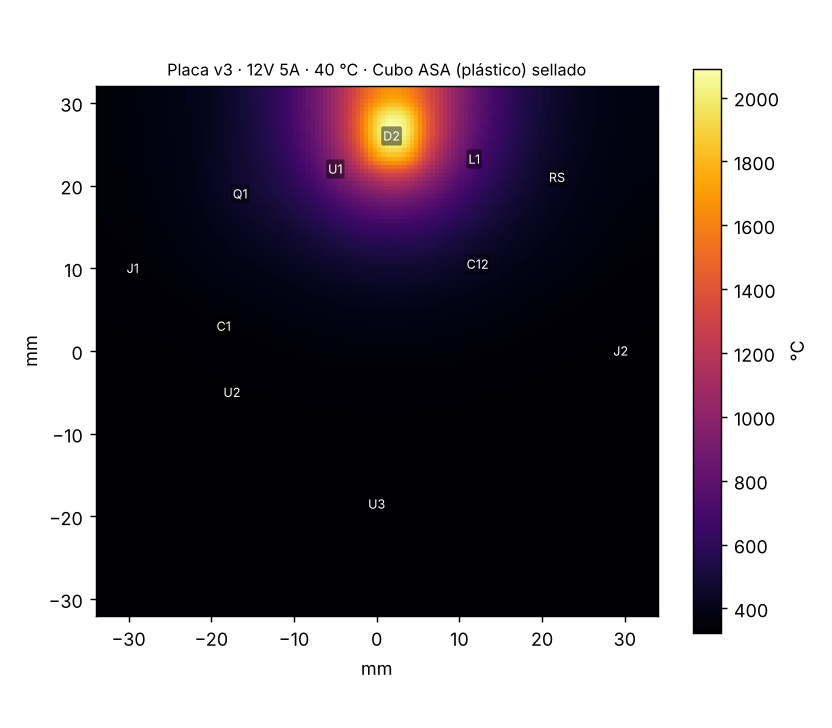
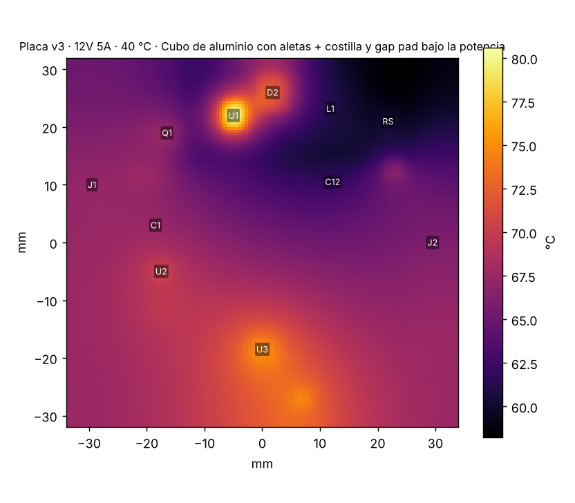
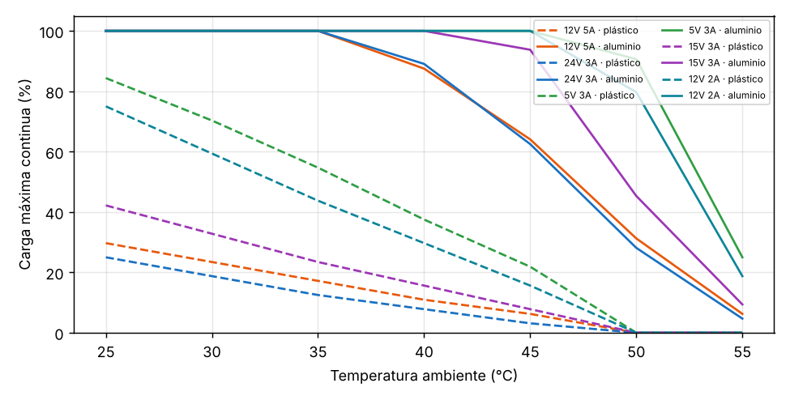
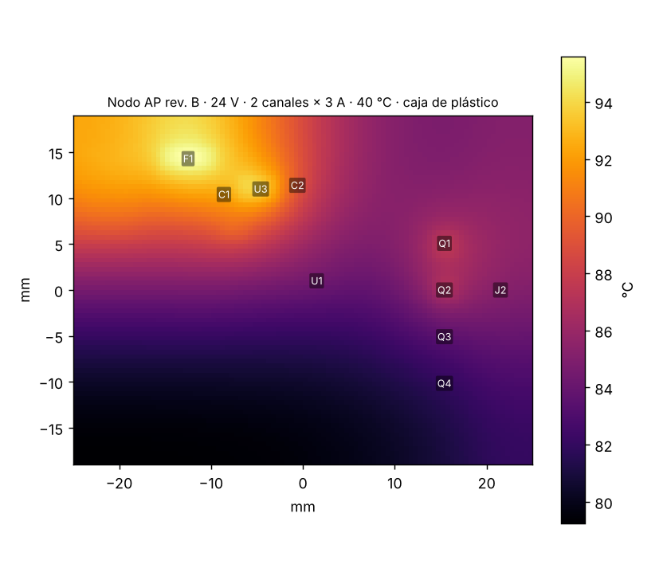

# Informe térmico · Cubo AP (placa v3) y Nodo AP

Generado por `analisis/termico.py`. **Estimación de primer orden (±15 K), sin prototipo medido.** Se valida con termopares en U1, D2, L1, C1, C12 y aire interior, y con cámara térmica, a 25 °C y en cámara a 45 °C.

## 1. Modelo

- **Pérdidas por pieza**, recalculadas con la temperatura: TPS54560 (conducción con Rds(on) de 92 mΩ +0.4 %/K, conmutación Vin²·fsw·I·0.25 ns/V, carga de compuerta, Iq), Schottky B560C (Vf·I·(1−D) + **fuga en inversa** Vin·Ir(T)·D, Ir ×10 cada 37.5 K + carga de la capacitancia), inductor (I²·DCR con +0.39 %/K + núcleo), shunt, MOSFET de canal (peor caso: toda la corriente en un canal), borneras, fusible, MOSFET de polaridad, buck de 5 V y LDO de 3.3 V, ESP32-C3.
- **Placa** como lámina 2D de celdas de 0.5 mm: conductancia en el plano 19.3 mW/K por cuadro (2 capas de 35 µm al 70 % + FR4). Cada cara: convección natural al aire interior y radiación a la pared (ε 0.9).
- **Convección natural** laminar h = 1.42·(ΔT/L)^¼ en cada superficie (3–6 W/m²K), radiación con h = εσ(T₁²+T₂²)(T₁+T₂). Caja: aire interior → pared, conducción por la pared, pared → ambiente. Aluminio: área efectiva ×2.2 por aletas; gap pad bajo la zona de potencia (900 W/m²K con vías térmicas); cartucho atornillado a la pared con pasta.
- **Cartucho AC-DC**: eficiencia 82–89 % según carga (típica de módulos IRM/LRS); su pérdida es la mayor fuente de calor.
- **Límites usados**: uniones ≤ 125 °C (margen de 25 K al máximo de 150 °C y de ~50 K al disparo térmico del TPS54560), ESP32-C3 ≤ 85 °C, aire interior ≤ 60 °C (los módulos AC-DC entregan el 100 % hasta 50–60 °C de aire).

## 2. Pérdidas en la placa por perfil (carga completa, 25 °C)

| Perfil | Cartucho | Ciclo D | U1 | D2 | L1 | Canal | Resto | **Placa** | **Cartucho** | **Total en el cubo** |
|---|---|---|---|---|---|---|---|---|---|---|
| 5V 3A | 24 V | 0.21 | 0.39 | 1.13 | 0.19 | 0.11 | 0.80 | **2.6 W** | **3.1 W** | **5.7 W** |
| 12V 1A | 24 V | 0.50 | 0.14 | 0.26 | 0.11 | 0.01 | 0.71 | **1.2 W** | **2.5 W** | **3.7 W** |
| 12V 2A | 24 V | 0.50 | 0.35 | 0.49 | 0.16 | 0.05 | 0.78 | **1.8 W** | **4.0 W** | **5.9 W** |
| 12V 5A | 24 V | 0.50 | 1.87 | 1.32 | 0.55 | 0.33 | 1.27 | **5.3 W** | **8.1 W** | **13.4 W** |
| 15V 3A | 24 V | 0.63 | 0.81 | 0.58 | 0.23 | 0.12 | 0.95 | **2.7 W** | **5.9 W** | **8.6 W** |
| 24V 2A | 36 V | 0.68 | 0.59 | 0.40 | 0.24 | 0.05 | 0.81 | **2.1 W** | **6.3 W** | **8.4 W** |
| 24V 3A | 36 V | 0.68 | 1.12 | 0.58 | 0.33 | 0.12 | 0.98 | **3.1 W** | **9.4 W** | **12.6 W** |

La pérdida del Schottky domina cuando el ciclo es bajo (5 V desde 24 V: conduce el 79 % del tiempo). El cartucho pierde más que toda la placa en los perfiles grandes.

## 3. Peor caso: perfil 12V 5A a 40 °C de ambiente

| Caja | Aire interior | Pared | U1 (unión) | D2 (unión) | L1 | ESP32-C3 | C1 | C12 | ¿Cumple? |
|---|---|---|---|---|---|---|---|---|---|
| Cubo ASA (plástico) sellado | > 150 °C | > 150 °C | > 150 °C (fuga térmica) | > 150 °C | > 150 °C | > 150 °C | > 150 °C | > 150 °C | **no** |
| Cubo de aluminio con aletas + costilla y gap pad bajo la potencia | 63 °C | 56 °C | 128 °C | 93 °C | 90 °C | 78 °C | 68 °C | 63 °C | **no** |

 

**Conclusión:** en el cubo de plástico sellado el aire interior es la resistencia que manda (el calor tiene que pasar placa → aire → pared con coeficientes de 3–5 W/m²K). Con 60 W de salida no es viable: el aire pasa de 60 °C, el cartucho sale de su curva y la fuga del Schottky D2 crece con la temperatura hasta desbocarse (fuga térmica). El cuerpo de aluminio con costilla y gap pad bajo la potencia saca el calor por conducción y deja las uniones con margen.

## 4. Curva de carga máxima contra temperatura ambiente

| Perfil · caja | 25 °C | 30 °C | 35 °C | 40 °C | 45 °C | 50 °C | 55 °C |
|---|---|---|---|---|---|---|---|
| 12V 5A · plástico | 30 % | 23 % | 17 % | 11 % | 6 % | 0 % | 0 % |
| 12V 5A · aluminio | 100 % | 100 % | 100 % | 88 % | 64 % | 31 % | 6 % |
| 24V 3A · plástico | 25 % | 19 % | 12 % | 8 % | 3 % | 0 % | 0 % |
| 24V 3A · aluminio | 100 % | 100 % | 100 % | 89 % | 62 % | 28 % | 5 % |
| 5V 3A · plástico | 84 % | 70 % | 55 % | 38 % | 22 % | 0 % | 0 % |
| 5V 3A · aluminio | 100 % | 100 % | 100 % | 100 % | 100 % | 91 % | 25 % |
| 15V 3A · plástico | 42 % | 33 % | 23 % | 16 % | 8 % | 0 % | 0 % |
| 15V 3A · aluminio | 100 % | 100 % | 100 % | 100 % | 94 % | 45 % | 9 % |
| 12V 2A · plástico | 75 % | 59 % | 44 % | 30 % | 16 % | 0 % | 0 % |
| 12V 2A · aluminio | 100 % | 100 % | 100 % | 100 % | 100 % | 80 % | 19 % |

**Cubo de plástico:** saca como máximo ≈ 19 W de salida a 25 °C, ≈ 15 W a 30 °C y ≈ 7 W a 40 °C. Sirve para interiores con 12 V 1 A o 5 V hasta 2 A; para lo demás, cuerpo de aluminio.

El firmware ya tiene **recorte térmico de 70 a 90 °C** medido en la placa (TH1 junto a L1): baja el brillo de forma lineal y apaga a 90 °C. Esta curva es la que se publica en la hoja de datos.

## 5. Sol directo

Con sol de 1000 W/m² sobre la tapa y una cara (absortancia 0.5, gris claro) entran ≈ 4.8 W más. En aluminio, 12V 5A a 40 °C: aire 68 °C, U1 134 °C, ESP32 83 °C (no cumple: el recorte térmico baja el brillo). Recomendación: acabado claro (anodizado natural o pintura blanca); un acabado negro casi duplica la carga solar.

## 6. Capacitores y calor

Regla aplicada: **ningún electrolítico junto a una fuente de calor**. Los cerámicos X7R de entrada y salida del reductor **deben** quedarse pegados a U1/D2/L1: el lazo de alta corriente conmutada tiene que ser lo más corto posible (si se alejan, sube la inductancia del lazo, los picos de voltaje en SW y la emisión electromagnética). Los X7R no se secan: aguantan 125 °C y no tienen desgaste por temperatura, solo pierden algo de capacitancia (±15 %).

| Pieza | Tipo | Temperatura (aluminio, 40 °C, 12V 5A) | Vida estimada | Acción |
|---|---|---|---|---|
| C1 entrada 100 µF 50 V | electrolítico 105 °C 2000 h | 68 °C | 3.0 años continuos | **cambiar a híbrido de polímero 125 °C 4000 h** → 24 años |
| C12 salida 100 µF 35 V | polímero sólido | 63 °C | 30 años | **movido a 2.5 mm de L1** (estaba a 0.2 mm del cuerpo del inductor) |
| C2 | cerámico X7R | 66 °C | sin desgaste térmico | se queda junto a su regulador (lazo corto) |
| C10 | cerámico X7R | 59 °C | sin desgaste térmico | se queda junto a su regulador (lazo corto) |
| C18 | cerámico X7R | 69 °C | sin desgaste térmico | se queda junto a su regulador (lazo corto) |
| C31 | cerámico X7R | 73 °C | sin desgaste térmico | se queda junto a su regulador (lazo corto) |

## 7. Nodo AP

Rev. A = diseño anterior (AO3400A SOT-23 de 26 mΩ, fusible 6.3 A, 78L05 directo). Rev. B = esta revisión (MOSFET DFN 3.3×3.3 de ≤ 10 mΩ, fusible 8 A, 150 Ω en serie con el 78L05).

| Caso (40 °C) | Caja | Pérdida | Aire interior | MOSFET (unión) | 78L05 (unión) | C1 | C2 | ¿Cumple? |
|---|---|---|---|---|---|---|---|---|
| Rev. A · 24 V · 2 × 3 A | plástico | 2.16 W | 76 °C | 147 °C | 133 °C | 115 °C | 112 °C | **no** |
| Rev. B · 24 V · 2 × 3 A | plástico | 1.34 W | 64 °C | 88 °C | 108 °C | 93 °C | 90 °C | sí |
| Rev. B · 24 V · 4 × 1.25 A | plástico | 0.96 W | 58 °C | 73 °C | 97 °C | 82 °C | 79 °C | sí |
| Rev. B · 12 V · 4 × 1.25 A | plástico | 0.72 W | 54 °C | 66 °C | 74 °C | 71 °C | 68 °C | sí |
| Rev. B · 24 V · 2 × 3 A | aluminio | 1.31 W | 53 °C | 56 °C | 89 °C | 75 °C | 70 °C | sí |
| Rev. B · 24 V · 4 × 1.25 A | aluminio | 0.95 W | 50 °C | 51 °C | 83 °C | 68 °C | 64 °C | sí |

El nodo no tiene reductor: su calor viene de los MOSFET, el fusible, las borneras y el regulador lineal. En la rev. A, con 6 A el fusible de 6.3 A trabajaba al 95 % de su nominal (los fusibles se usan a ≤ 75 % y menos con calor) y los AO3400A en SOT-23 pasaban de 140 °C. La rev. B usa MOSFET DFN de ≤ 10 mΩ con pad de drenaje al cobre, fusible de 8 A y límite de **5 A en total** (3 A por canal). La resistencia de 150 Ω reparte el calor del 78L05 y deja funcionar el nodo desde 12 V (el 78L05 necesita ≥ 6.7 V en su entrada). C1 y C2 son cerámicos X7R que deben ir pegados al regulador para su estabilidad; no tienen desgaste por temperatura.

## 8. Cambios de diseño que salen del análisis

1. **Cuerpo de aluminio** (fundición o maquinado, aletas en las 4 caras laterales, anodizado claro) para los perfiles de más de 25 W; el de plástico queda para interiores hasta ≈ 15 W (12 V 1 A, 5 V 2 A). La antena ya es externa (U.FL), así que el metal no estorba la radio.
2. **Costilla interna + gap pad** (3 W/m·K, 1 mm, aislante) bajo la zona U1–D2–L1–RS–Q1, con **vías térmicas** en esa zona de la placa. La placa queda flotante eléctricamente: el gap pad aísla.
3. **Cartucho atornillado a la pared** de aluminio con pasta o pad térmico; no flotando en el aire.
4. **C1 → híbrido de polímero 125 °C** (misma huella 8×10), **C12 → 2.5 mm de L1** (antes 0.2 mm) (aplicado en la placa v3); la placa ya lleva **4 vías térmicas bajo el PowerPAD de U1 y 4 bajo el ánodo de D2** hacia el plano inferior.
5. **Nodo rev. B:** MOSFET DFN 3.3×3.3 de ≤ 10 mΩ, fusible de 8 A, 150 Ω en serie antes del 78L05 y límite de 5 A total (aplicado y reruteado).
6. **Hoja de datos:** curva de carga contra temperatura ambiente; rango de operación −20 a +50 °C; acabado claro en exteriores.
7. **Siguiente revisión de la placa (v4):** cambiar el reductor asíncrono (TPS54560 + Schottky) por uno **síncrono** de 60 V 5 A (p. ej. LM76005): desaparece D2 y su fuga, y la pérdida a 12 V 5 A baja de ≈ 3.2 W a ≈ 1.5 W. Mientras tanto, D2 puede ser un rectificador de baja fuga (trinchera o SBR) de 60 V 5 A en SMC.
8. **Nodo AP:** caja de perfil de aluminio con gap pad bajo los MOSFET para instalaciones de 5 A continuos o a más de 35 °C.
